<div align="center">

# ⎈ Oxikube

### The Kubernetes desktop client that keeps up with you.

**Native. GPU-rendered. Keyboard-first. Written in Rust.**<br>
Everything you love about Lens, the speed of k9s, and the feel of Zed — in one app with no Electron, no login wall and no lag.

[](LICENSE)


<br>

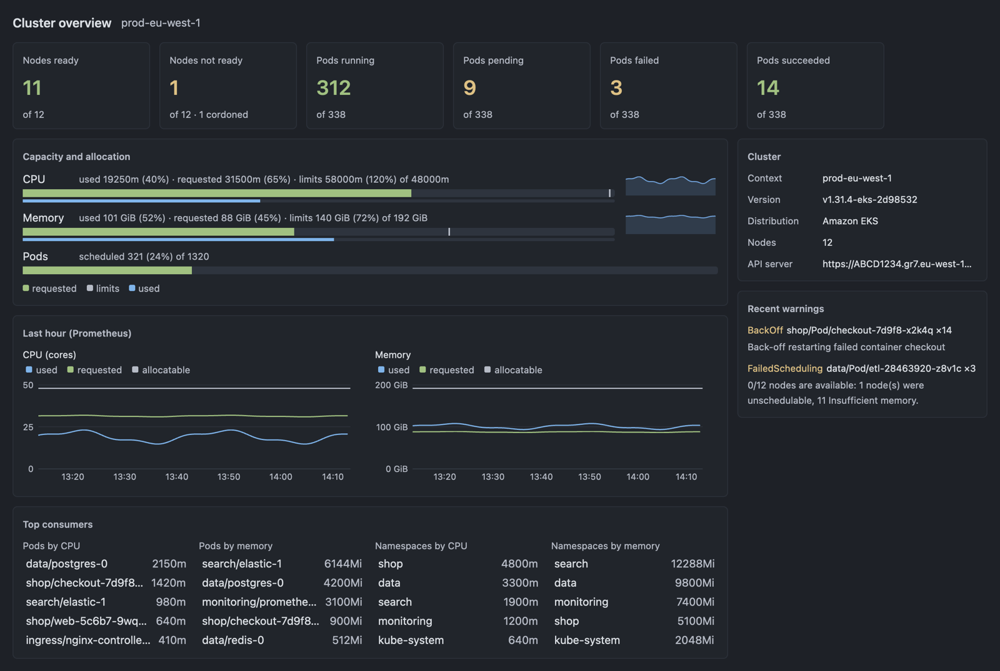

</div>

---

## Why Oxikube?

Your cluster changes every second. Your Kubernetes client shouldn't stutter while it does.

- 🚀 **Smooth as Zed.** Oxikube draws on the GPU with [GPUI](https://www.gpui.rs/), the framework behind the Zed editor. The performance budget is written down and enforced: **every frame in ≤ 8.33 ms** (one 120 Hz refresh) with **zero dropped frames** in a 10,000-pod cluster under churn, cold start to an interactive window in **≤ 400 ms**, and nothing blocking the UI thread. Ever. ([docs/PERFORMANCE.md](docs/PERFORMANCE.md))
- ⌨️ **Keyboard-first, mouse-friendly.** A Zed-style command palette, k9s-style `:` jumps, `/` to filter anything, and a fully rebindable keymap. Click when you want to, never because you have to.
- 🛡️ **Safe by design.** Every change goes through one guard: per-cluster read-only mode, confirmation tiers ("type the name" for the scary stuff), server-side dry run with a diff before apply, and a local audit log.
- 🔐 **Your secrets stay secret.** Credentials live in the OS keychain or in memory, never in a file. Logs and audit entries are redacted.
- 🦀 **Native and light.** A single Rust binary. No Chromium, no Node, no account, no telemetry unless you opt in.
- 🆓 **Free and open source.** GPL-3.0-or-later, the same model as Zed.

---

## A tour

### 🗂️ Every cluster, one home

Oxikube reads all your kubeconfigs (and keeps watching them), so every context shows up the moment you add it. Connect to several clusters at once, each in its own tab. Expired tokens, broken configs and unreachable API servers are explained in plain words, right where you'd look.

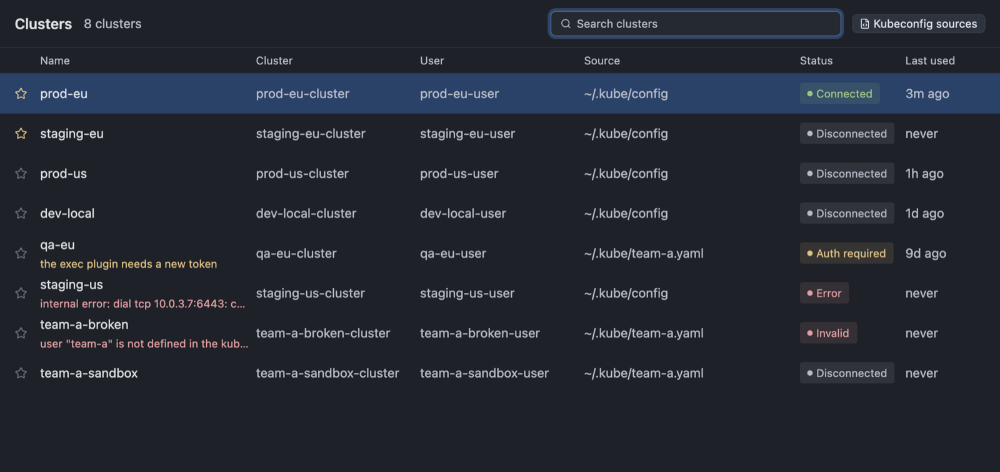

### 📊 See the whole cluster at a glance

Node and pod health, capacity against requests and limits, an hour of history from Prometheus (or live numbers from metrics-server), the warnings that matter and the pods eating your CPU. Workload cards show what's healthy and what's not before you open a single table.

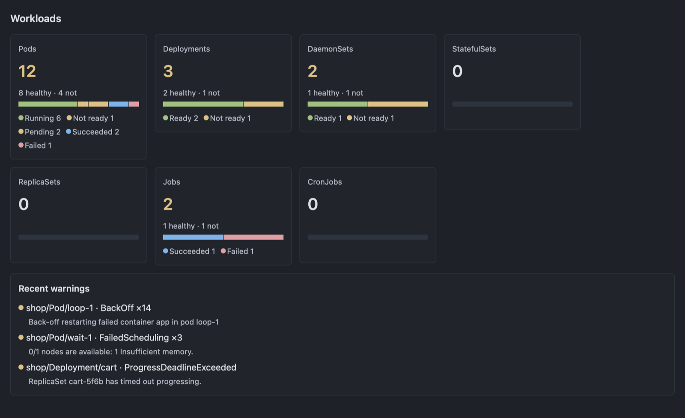

### ⚡ Tables that never flinch

Virtualised, live-updating tables for every kind, CRDs included. Filter by name, `!not`, `-l` labels or `-f` fuzzy, sort any column, choose your columns, and spot trouble with warning badges before you scroll.

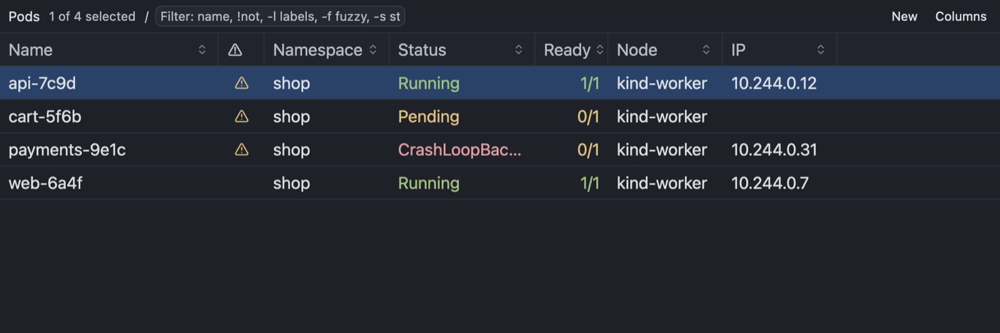

### 🔎 Details that answer the next question

Each kind gets a real panel, not a YAML dump: containers and probes, the owner chain you can click through, the node, and environment variables traced back to the ConfigMap or Secret they came from (secrets stay masked until you ask). Overview, YAML, Describe and Events are one tab away.

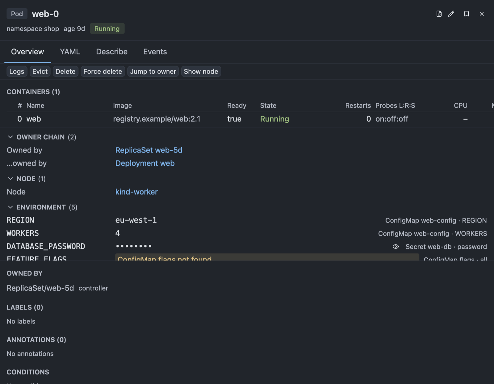

### 📜 Logs you can actually read

Tail one pod or merge a whole deployment, stern-style, with each pod in its own colour. Regex search with highlights, level filters, line wrapping, and structured JSON logs expanded with one click.

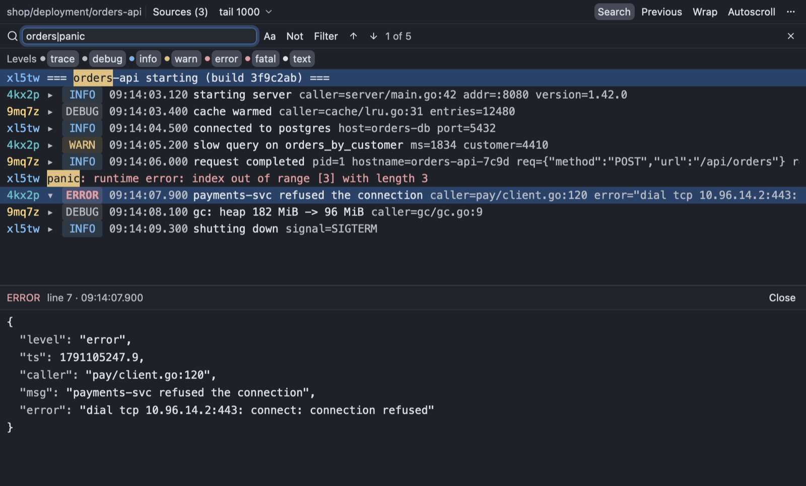

### ✍️ An editor that knows Kubernetes

Edit manifests with schema-aware validation and completion pulled from *your* cluster's OpenAPI, so CRDs work too. See a diff against the live object before you apply, then let the server dry-run it first.

<table>
<tr>
<td width="45%">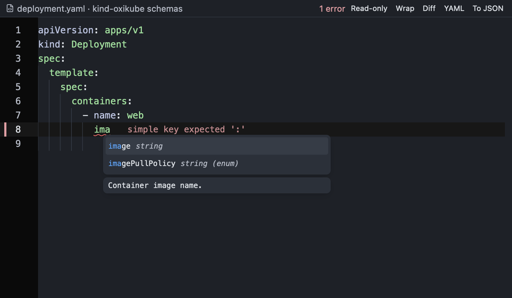</td>
<td width="55%">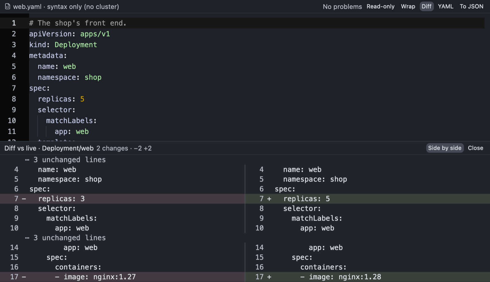</td>
</tr>
</table>

### 🔔 Events, without the noise

A live, sortable event stream across the cluster. One click for faults only, filter by reason, kind, namespace or regex, pause it, copy it, export it as JSON.

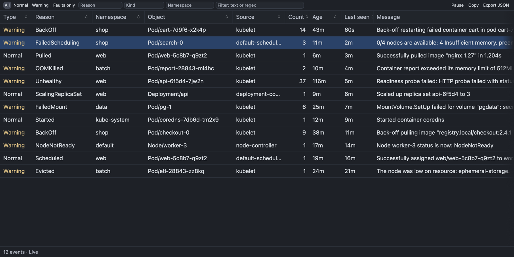

### 💻 A real terminal, built in

Exec into containers, run `kubectl`, `helm` or your shell, with the cluster's environment already set. Tabs and splits work like in Zed, and full-screen programs like `vim`, `less` and `tmux` just work.

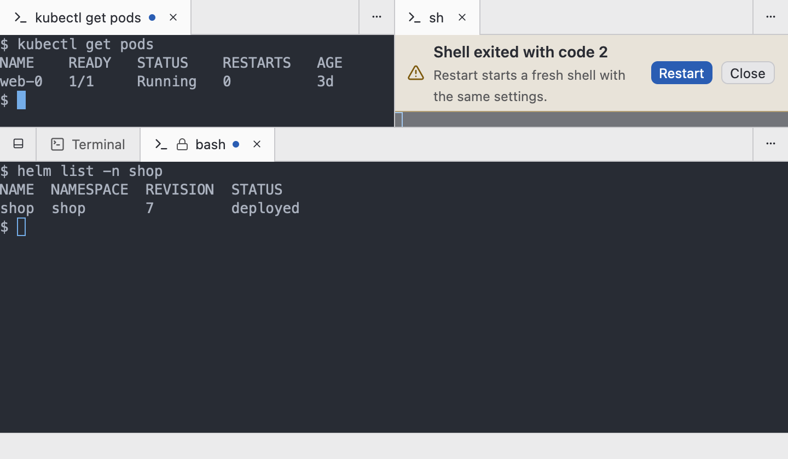

### 🎯 Command everything

Every action in Oxikube is a command, so every action is in the palette and can have a key. Press `?` to see every binding available where you are.

<table>
<tr>
<td width="50%">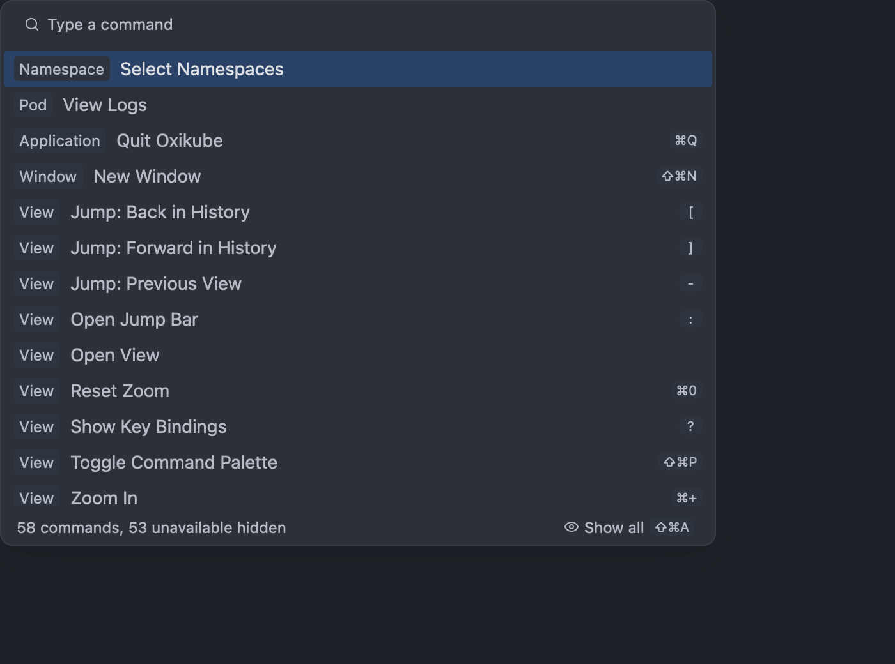</td>
<td width="50%">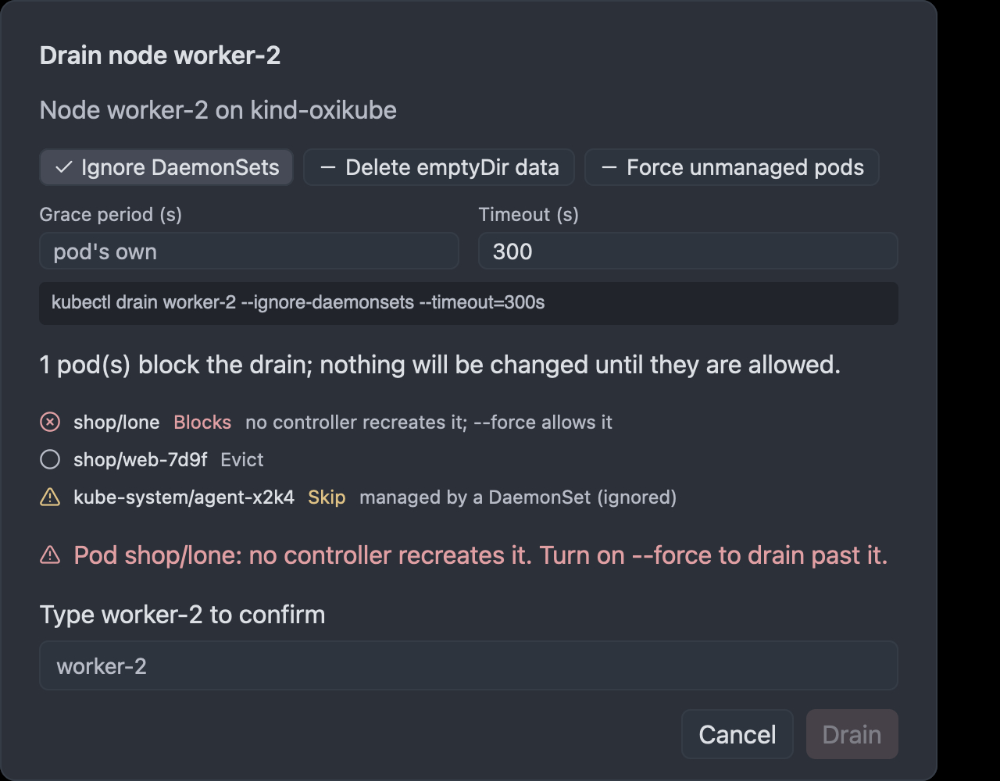</td>
</tr>
<tr>
<td align="center"><sub>Command palette with your bindings</sub></td>
<td align="center"><sub>Risky actions show the plan first and ask you to type the name</sub></td>
</tr>
</table>

---

## How it compares

|  | **Oxikube** | Lens / OpenLens / Freelens | k9s |
|---|:---:|:---:|:---:|
| Native app, no Electron | ✅ | ❌ | ✅ (terminal) |
| GPU-rendered GUI | ✅ | ❌ | ❌ |
| Keyboard-first (`:` jump, `/` filter, palette) | ✅ | ➖ | ✅ |
| No account or login wall | ✅ | ➖ | ✅ |
| Schema-aware manifest editor with live diff | ✅ | ➖ | ❌ |
| Read-only mode, dry run, audit log | ✅ | ➖ | ➖ |
| Built-in terminal with tabs and splits | ✅ | ✅ | ❌ |
| Open source | ✅ GPL-3.0 | ➖ varies | ✅ |

---

## Getting started

> **Oxikube is pre-release.** There are no packaged builds yet (signed `.dmg`, `.deb` and AppImage releases with auto-update are on the [roadmap](#roadmap)). For now, build it from source. It takes a few minutes and one command.

**Requirements**

- macOS or Linux
- [Rust via rustup](https://rustup.rs) (the pinned toolchain in `rust-toolchain.toml` installs itself)
- On Linux, the GPUI system libraries:

  ```sh
  sudo apt-get install -y libasound2-dev libfontconfig-dev libfreetype-dev libglib2.0-dev libssl-dev \
    libvulkan1 libvulkan-dev libwayland-dev libx11-xcb-dev libxcb1-dev libxkbcommon-dev \
    libxkbcommon-x11-dev libzstd-dev libsqlite3-dev cmake clang pkg-config
  ```

**Build and run**

```sh
git clone https://github.com/karan-vk/Oxikube.git
cd Oxikube
cargo run --release -p oxikube
```

Oxikube picks up `~/.kube/config` (and `$KUBECONFIG`) automatically. Pick a cluster and go.

**Want a playground cluster?** With [kind](https://kind.sigs.k8s.io) installed:

```sh
cargo xtask kind-up                      # a local kind cluster
cargo xtask load-pods --count 10000 --churn   # 10k churning pods, to see how smooth it stays
```

---

## Roadmap

Oxikube is built in the open, epic by epic, from a public [plan](docs/PLAN.md).

| | Milestone | What you get |
|:---:|---|---|
| ✅ | **Foundation** | Workspace, cluster connection and auth, live data plane, the Zed-like shell |
| ✅ | **Core Kubernetes** | Cluster catalog, resource browser for every kind incl. CRDs, logs, terminal and exec, manifest editor, palette and keymaps |
| 🚧 | **Lens parity** | ✅ per-kind panels and actions · ✅ metrics and overview · ✅ events and notifications · port-forward manager, Helm, RBAC, cloud discovery (EKS/GKE/AKS), apply/kustomize |
| 🔜 | **Zed-style platform** | Settings and keymap UI, Zed theme import, WASM extensions, signed releases and auto-update |
| 🔜 | **Argo CD** | Optional, native Argo CD and Rollouts views |
| 🔜 | **Agents** | Claude Code, Codex, Gemini and more hosted in a panel, with cluster tools behind the same safety guard |

---

## Contributing

Contributions are welcome. Start with:

- [`docs/ARCHITECTURE.md`](docs/ARCHITECTURE.md): the crate map and hexagonal layer rules
- [`docs/CONTEXT.md`](docs/CONTEXT.md): the domain glossary
- [`docs/PERFORMANCE.md`](docs/PERFORMANCE.md): the performance budget every change is held to
- [`.claude/skills/oxikube-contributor/SKILL.md`](.claude/skills/oxikube-contributor/SKILL.md): the working agreement (branches, reviews, tests)

```sh
cargo xtask setup                                   # install the git hooks
cargo test --workspace                              # unit and UI tests
cargo clippy --workspace --all-targets -- -D warnings
```

<sub>The screenshots in this README are rendered by Oxikube's own UI tests against sample data.</sub>

## License

Oxikube is licensed under [GPL-3.0-or-later](LICENSE). Third-party code and its licences are listed in [THIRD_PARTY_NOTICES.md](THIRD_PARTY_NOTICES.md).

<div align="center">
<br>
<b>Stop waiting on your Kubernetes client.</b><br>
⭐ Star the repo to follow along.
</div>
