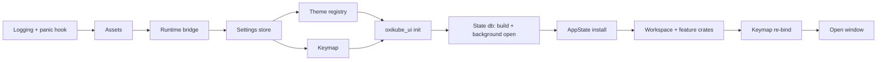

# Oxikube architecture

Oxikube is a native Kubernetes desktop client written in Rust on GPUI (Zed's UI framework).
It is organised as a hexagonal (ports & adapters) workspace so that the domain and the
use-cases never know about kube-rs, GPUI, SQLite, Argo CD or ACP. Adapters implement ports;
the binary wires them together.

## Layers and dependency direction

```
domain  ←  ports  ←  app  ←  (ui, bins)
             ↑
          adapters        (implement ports; never depend on app or ui)
platform                  (settings / keymap / theme / runtime / extension host; → domain, ports)
bins/oxikube              (wires adapters into app, mounts ui)
```

| Layer (`crates/<layer>/`) | May depend on (internal) | Must not depend on (external) |
|---|---|---|
| `domain` | nothing | gpui*, kube*, k8s-openapi, tokio, reqwest, rusqlite, wasmtime |
| `ports` | domain | gpui*, kube*, k8s-openapi, reqwest, rusqlite, wasmtime |
| `app` | domain, ports | gpui*, kube*, k8s-openapi, reqwest, rusqlite, wasmtime, agent-client-protocol, rmcp |
| `adapters` | domain, ports | gpui* |
| `platform` | domain, ports, platform | kube*, k8s-openapi, gpui-component |
| `ui` | domain, ports, app, platform, ui | kube*, k8s-openapi; `gpui-component` only inside `oxikube_ui` |
| `testing` | domain, ports | gpui-component |
| `bins`, `xtask` | anything | – |

`cargo xtask lint-deps` parses `cargo metadata` and fails CI on any violation. Dev-dependencies
are exempt so tests can use `oxikube_testkit` freely.

Why so strict: multiple agent teams work in parallel. The layer rules are what let a team
replace an adapter (kube-rs → something else, gpui-component → in-house) or add an integration
(Argo CD, Flux) without touching the core, and let the domain/app layers be tested with fakes
in milliseconds.

## Crate map

See `docs/PLAN.md` ("Workspace layout") for the one-line responsibility of every crate, and each
crate's `README.md` for its allowed dependencies. Highlights:

- `oxikube_domain` — ids, `ResourceKind`, the thin `Resource { meta, doc }` model (the object's JSON as a compact `JsonDoc` read in place through `JsonRef`; `StrMap` label sets and `intern`ed strings shared across objects), view-models,
  `Quantity`, `Age`, session state and `NamespaceSelection`, `Command` / `Capability` vocabulary,
  safety types (`Risk`, `ConfirmTier`, `Initiator`), `AuditRecord`, telemetry-free records
  (`LogLine`, `Event`, `MetricsSample`, `ContextBlock`), the error taxonomy and the pure
  secret scrubber `redact` (`redact(&str) -> Cow<str>`, `Redacted<T>`, the pattern catalogue).
  Module `view::storage` (E12-S15): `PvcSummary`, `PvSummary`, `StorageClassSummary` (`is_default_class` reads both
  default annotations), `VolumeSnapshotSummary` / `VolumeSnapshotClassSummary`, `AccessMode` / `ReclaimPolicy`,
  `pod_claims` (the claims a Pod mounts) and `check_resize` (a new size must be greater than the current one and the
  class must allow expansion; the one rule the resize dialog and the `pvc::Resize` handler share).
  Terms are defined in `docs/CONTEXT.md`.
- `oxikube_ports` — every async, object-safe trait (`ResourcePort`, `LogPort`, `ExecPort`,
  `StatePort`, `IntegrationPort`, `ToolPort`, `AgentPort`, …) with the transport types they
  exchange (`Delta`, `Table`, `ToolDef`, …). One module per port; each names its adapter.
- `oxikube_testkit` — a `Fake*` for every port, fixtures and builders, `TestPorts` (the seeded fakes
  `AppState::test` is built from), and the GPUI test harness (`gpui_test::TestApp` / `TestWindow`,
  `ScreenshotApp` with golden compare; `docs/testing-gpui.md`; the logs test matrix is `docs/testing-logs.md`).
- `oxikube_settings::aliases` (E11-S04) — the user's `aliases.json` next to `settings.json`: a JSON-with-comments
  object from alias to a resource (`"apps/v1/deployments"`, `{ "gvr": .. }`) or a command line (`"pod fred app=blee"`,
  `{ "command": "pod", "args": [..] }`). `parse_aliases` skips a bad entry and reports it with its line (names the jump
  bar would misread, wrong types, unknown fields, repeats); a file that is not JSON keeps the last good aliases.
  `UserAliasesFile::open(path, watch, on_change)` reads, watches (`watch: false` in tests plus an explicit `reload`) and
  calls back from the watcher's thread; `oxikube_assets::aliases_schema()` is the schema editors use. The app layer
  cannot depend on this crate, so `bins/oxikube::aliases` pushes the result into `AliasRegistry::set_user_aliases`.
  `oxikube_domain::AliasTarget` (a `Gvr` or a `Command { name, args }`) is the one type both sides share.
- `oxikube_app` — services: `ClusterSessionManager`, `ResourceStore`, `CommandBus`,
  `MutationGuard`, `LogService`, `PortForwardManager`, `IntegrationRegistry`, `ToolRegistry`,
  `ContextRegistry`, `AgentSessionManager`. No gpui, no kube. Module `search::fuzzy` (E11-S11): `FuzzyService`, the one
  fuzzy ranking engine (`nucleo-matcher`, smart case, normalisation on, the query is plain text) the command palette, the
  pickers and the jump bar share: `rank(query, candidates, limit) -> Vec<Match { index, score, positions }>` (`rank_with`
  adds a per-candidate recents place), `&self` over a pool of matchers (each call borrows one; scratch buffers are
  reused, so a keystroke allocates only the pattern and the result), a total deterministic order (score, then recents,
  then alphabetical, then the caller's order), the weights of the exact / prefix / recents boosts in `search::fuzzy::score`
  (all small next to nucleo's per-character score; the ranking tests pin them), `highlight::matched_ranges` for the views and
  `QueryGeneration` to drop stale async results. 2 000 candidates rank in well under a millisecond (budget 5 ms,
  `cargo bench -p oxikube_app --bench fuzzy_rank`). Module `search::recents` (E11-S11): `StateRecents` (the
  `RecentsStore` behind the palette's recents-first order, key `recents.commands`, 50 command ids, global) and
  `JumpRecents` (the `:` bar's lines, key `history.jump/<cluster>`, 100 per cluster, deduplicated by whitespace-normalised
  text, a line the redaction patterns would change is never kept) over `StatePort` kv: every call answers from memory,
  a writer task (`run_writer`, started by the binary's `history` module) writes behind a 500 ms pause and the app
  flushes on quit; an unavailable state db leaves them in memory and logs one line (the error's kind, never its text).
  Module `search::aliases` (E11-S04): `AliasTable`, the words
  the `:` jump bar understands, in three layers with the precedence user `aliases.json` > built-in k9s names (`po`, `dp`,
  `svc`, ... as a data table that follows the version the cluster prefers) > discovery (plural, singular, short names,
  lower-cased Kind and `plural.group` of every served type, CRDs included, preferred version only). `resolve` is a hash
  lookup, case-insensitive, allocation-free for a known word (a test counts allocations; about 15 ns) and returns
  `Exact`, `Ambiguous` (two groups with one plural; candidates in a fixed order, core group first, then by group, so the
  first never depends on discovery's order) or `Unknown { suggestions }` (prefix and edit distance). Every collision is
  in `conflicts()` (`Shadowed`: a higher layer hides lower entries that lead elsewhere; `Ambiguous`), never silent.
  `AliasRegistry` holds one table per cluster and the user's aliases for all; `follow(sessions, runtime)` fills a table
  when its session connects, applies a CRD change by resolving only the kinds it names (one cluster's worker task each),
  and clears discovery on disconnect. Module `search::jump` (E11-S05): the `:` jump bar's grammar and planner, plain Rust.
  `parse` is a hand-written tokenizer and a loop (`:<alias> [ns] [/filter] [k=v,..] [@ctx]`, `:ctx [name]`, `:ns [name]`,
  `:q`, `-` `[` `]`) returning a `JumpCommand` or a `ParseError` with the `Span` to underline; the `/filter` stays an
  uninterpreted `RawFilter` for the filter bar's grammar (`store::filter`, which now also reads `name -l selector`).
  `plan(line, &dyn JumpEnv)` resolves a line against the shown cluster's alias table (`AliasTable::gvk_of` gives the
  Kind a list is opened by), its namespace list and the cluster contexts, and returns a `JumpPlan`: the navigation
  `Command`s that do it (`resource::OpenList`, `namespace::Select`, `table::SetFilter`, `cluster::Select` or
  `cluster::Connect` with the rest after the connection, `view::Open catalog`, `app::Quit`, `jump::Back|Forward|Last`),
  with suggestions for an unknown alias, namespace or context and a user alias that is a command line expanded
  (loops stop at four levels). `JumpHistory` is the session ring (`[` back, `]` forward, `-` previous view and back; E11-S11 `seed`s it from the stored `JumpRecents` of the shown cluster when the bar first opens, and the bar records every confirmed line there);
  `site` / `candidates` / `accept` are the completion of the word under the caret. Module `sidebar` (E06-S10):
  `review_access` (the rules reviews the cluster sidebar hides sections by; fails open) and
  `discover_custom_resources`; module `integrations`: the `IntegrationRegistry` stub. Module `session` (E06-S01):
  `ClusterSessionManager` connects a context through `ClusterConnectorPort`, holds the returned
  `ClusterPorts` bundle per session, drives `ClusterSessionState` (auth failures to
  `AuthRequired`, transient ones retried with backoff on the `ClockPort`, health reports for
  `Ready` ↔ `Degraded` → `Error`, or `AuthRequired` for credentials rejected for good) and
  broadcasts `SessionUpdate`s. After a health `Failed` with a transient cause (`Network`,
  `Timeout`, retryable `Auth`) it reconnects by itself on the `SessionManagerConfig::auto_reconnect`
  backoff (module `reconnect`, E06-F440; `ClusterSession::auto_reconnect` says what is planned,
  any user connect / disconnect / close cancels it). It spawns two things: that reconnect
  schedule, and the per-connection forwarder of `DiscoveryPort::subscribe` events (a CRD added or removed becomes
  `SessionChange::KindsChanged`, a refused CRD watch `CrdWatchChanged`; E03-F544), owned by the
  session entry and aborted when the connection is released (callers drive `connect` with
  `spawn_kube`, dropping it cancels the attempt). Per-cluster settings
  (E06-S08): the binary pushes a `ClusterPrefsTable` (`oxikube_ports::cluster_prefs`, resolved by
  `oxikube_settings::ClusterSettings` from `clusters.<id>`) into `set_prefs_table`; new sessions
  start from it and open ones follow it live (read-only, colour, display name; exec policy on the
  next connect), with a `SessionChange` per field for the clusters that changed.
  Module `catalog` (E06-S03):
  `ClusterCatalog` joins the `ClusterSourcePort` contexts (name, kubeconfig cluster and user,
  source file, `problem` when the context names a cluster or user the kubeconfig lacks) with the
  user's favourites and last-used times in the `cluster_catalog` state table; reading it is local,
  never a network call. `ClusterCommands` runs `cluster::Connect`, `cluster::Reconnect` (the
  retry), `cluster::CancelConnect` (only while an attempt is in flight), `cluster::Disconnect` and
  `cluster::ToggleFavourite` (reads, so no `MutationGuard`); the `CommandBus` (E06-S02) registers it.
  A `ClusterSession` also carries the API server URL of its catalog entry (`server()`).
  Module `sources` (E06-S05): `KubeconfigSourcesService` manages the user's kubeconfig sources
  (`add` a file or folder, `add` pasted text, `remove`, `reload`, `rows` with each source's status)
  over a `SourceListStore` (settings in the app), the `ClusterSourcePort` (`set_user_sources`,
  `source_statuses`, `validate_kubeconfig`) and the `FsPort` (`write_private`, `remove`); a pasted
  kubeconfig is stored `0600` as `<config dir>/kubeconfigs/<name>.yaml` (ADR 0015), only such files
  are ever deleted, and the `kubeconfig::*` handlers register with `register_commands`.
  Module `session::namespaces` (E06-S07): `NamespaceService` sets a session's `NamespaceSelection`
  (one `NamespaceChanged` per change, 150 ms debounce on the `ClockPort`), remembers selection,
  favourites and typed names per cluster in `StatePort` (kv `cluster/<id>/namespaces`), lists
  namespaces through `ResourceReader` (a `403` falls back to the typed names), drops stale
  selected names, maps `0`-`9` to All / the first nine favourites, computes a `ScopeDelta` for
  the `ResourceStore`, and runs the `namespace::Select` / `namespace::ToggleFavourite` commands.
  Module `store` (E07-S01): `ResourceStore`, the per-session cache behind every table, sidebar count
  and overview tile. Entries are keyed by (gvk, `FeedScope`: the cluster or one namespace); the
  table-driven `FeedPolicy` picks the port call (reflector or metadata-only `ResourceReader::watch`
  for core kinds, `TableFeedPort::table_feed` for CRDs and unknown kinds, ADR 0006); a `FeedBudget`
  hook admits, degrades or refuses new feeds (evicting idle ones first). `subscribe(StoreQuery)`
  returns a `Subscription` stream of `StoreDelta`s: a snapshot first, then coalesced `RowOp`s with
  positions in the subscriber's own sorted, filtered index (no re-sort per event), plus the
  `FeedState`. Feeds run on an injected `Spawner` (the Tokio bridge in the binary) under
  abort-on-drop guards; the last subscriber's drop starts a grace timer on the `ClockPort`, after
  which the feed is aborted. `Subscription::rescope` follows a namespace change with the
  `ScopeDelta`, keeping the feeds that stay. `ResourceStores` keeps one store per connected session.
  Counts (E07-S11, `store::counts`): `ResourceStore::counts(targets, selection)` answers each kind with a `CountState`
  from the caches' running health tallies (O(1), no feed started; a kind nobody watches is `NotWatched`), `CountsLease`
  holds the feeds a view needs through `subscribe` with a filter that matches nothing (no row index), and `health_of`
  (`oxikube_domain::view`) is the one healthy rule. A forbidden kind is `NoAccess`, a budget refusal `OverBudget`.
  Module `columns` (E07-S02): `ColumnProvider`, the one question a table asks of a kind (`columns(kind,
  caps)` and `cell(object, column, now)`), with two implementations (ADR 0006). `CoreColumns` is a
  table-driven catalogue of ~40 core kinds (computed `Ready` / `Status` / `Restarts` from the domain
  view-models, JSON-pointer columns for the rest, CPU/memory as `Cell::Pending` hooks that a
  `MetricsSource` fills in E13); `TableColumns` maps one Table feed's `columnDefinitions` (priority >
  0 is the `wide` flag) and rows, recovering typed sort keys from the server's text and substituting
  generic Name / Namespace / Age for a `TableSource::Objects` feed. A `Cell` carries display text, a
  typed `CellSort` (number, quantity, age, time, text) and a `Tone`; colours stay in the theme.
  The store sorts by any column through `SortField::Cell(CellSortKey)`: each object ranks by its
  cell's typed sort key, read once per object version from the view's provider (E07-S03).
  Module `columns::pods` (E12-S02): `PodColumns`, the Pod kind's own provider (registered through its `KindSpec`):
  Name, Namespace, Ready, Status, Restarts (+ last restart), CPU, Memory, `%CPU/R`, `%CPU/L`, `%MEM/R`, `%MEM/L`,
  IP / Node / QoS (hidden by default), Service Account, Controlled By, Age; every computed cell reads one `PodSummary`
  memoised per object version (keyed by namespace and name, a hit needs the same `JsonDoc`), usage from a
  `MetricsSource` set with `set_metrics` (E13), `–` without one.
  Module `namespaces` (E12-S16): the Namespace kind itself (what a session watches stays in `session::namespaces`):
  `register_commands` installs `namespace::Create` (low risk, one confirm; a server dry run, then the create under the
  field manager, no second apply path) and `namespace::Delete` (irreversible: the name is typed; a dry run, then the
  delete; a namespace goes `Terminating`, the result says so; the audit record carries what it held, `contents=Pod:12,...`),
  both only behind the `MutationGuard`; `NamespaceCreator` is what the create dialog runs on the bus as the user;
  `delete_advice` reads the store's caches (never starting a feed) for the warnings of `oxikube_domain::view::delete_notes`
  (system namespaces, HNC parent and subnamespace markers, already terminating, counts of `CONTENT_KINDS`) and
  `delete_command` makes `DeleteFlow::with_command` delete with `namespace::Delete`; `NamespaceColumns` is the
  Namespaces table's provider: the core columns plus **Pods** read from `ResourceStore::count_in_namespace` (the pods
  feed's per-namespace index, O(1), `–` when no listed feed covers it), built per cluster through
  `KindColumns::PerCluster` / `ColumnsContext` and holding a `CountsLease` on pods and deployments while a table uses it.
  `NamespaceService::use_favourite` / `use_favourite_now` run `namespace::UseFavourite` (`0` All, `1`-`9` the nth
  favourite; immediate when the favourites are loaded). "Use this namespace" is `namespace::Select` with one name.
  Module `nodes` (E12-S09): `nodes::set_unschedulable` (cordon / uncordon: the `spec.unschedulable` merge patch, `null` to clear it as
  `kubectl uncordon` does, through the guard's `Mutation`: a server dry run first, then the patch) behind the
  `node::Cordon` / `node::Uncordon` handlers (`nodes::register_commands`; risk `Low`, one click, blocked read-only, audited
  with the node and the initiator), `NodeColumns` (the node table's provider over `CoreColumns`: Pods from the pods-by-node
  index, CPU% / Mem% as `NodeUsageSource` slots E13 fills, `–` while absent; built per cluster through `KindColumns::PerCluster` / `ColumnsContext`, which hands it the cluster's store) and `list_node_pods` (the
  `spec.nodeName=<node>` field-selector fallback). Module `store::nodes` (E12-S09): `ResourceStore::lease_node_loads` ->
  `NodeLoadsLease`, which holds the cluster-wide Pod feed open and switches on `PodsByNode` in that feed's cache: pods
  grouped by `spec.nodeName` with the summed `Demand` (requests and limits, `PodPlacement::of_pod`), updated per delta in
  O(containers) and built from the cache in one pass when a lease arrives, so a session that never opens Nodes pays nothing
  per pod; reads answer `None` until the Pod feed is ready.
  Module `kinds` (E12-S01): `KindRegistry` of `KindMeta`s (gvk, plural, title, scope, `KindColumns`, actions as
  `CommandId`s checked against the domain's declarations, `SidebarSlot`, template names), O(1) lookup by group and kind
  with the generic fallback (`kind_for`), `sidebar_tree(gate)` (sections and entries by explicit rank, so registration
  order never matters; searchable), `templates_for(gvk, catalog)`; `KindGate` joins `ServedKinds` (discovery presence)
  and the `KindVisibility` hook (E17's RBAC gate; `AllowAll` until then). `sidebar::discover_sidebar` reads discovery once
  for the served kinds and the custom resources.
  Module `workloads` (E12-S04): `WorkloadService`, the replica controllers' actions. `plan_scale` reads the `scale`
  subresource (current and desired counts, a HorizontalPodAutoscaler that targets the workload as a soft hint);
  `scale(&Mutation, target, replicas)` runs inside the guarded `workload::Scale` handler (`register_commands`),
  patches `spec.replicas` through `ResourceWriter::scale` (never the object; a dry-run dispatch has the server rehearse
  it), and notes `before=` / `after=` in the audit record through `Mutation::note`. Risk is Low, Medium for zero
  (`Command::effective_risk`); both are one simple confirmation. `ScaleRunner` dispatches it for the dialog, answering
  that confirmation on the user's behalf. A DaemonSet is refused (no scale subresource). `oxikube_domain::view`
  gained `WorkloadKind::ReplicationController` and `WorkloadDetail` (pod template, strategy, selector, conditions).
  Module `storage` (E12-S15): `register_commands` installs the `pvc::Resize` (risk medium) and `storageclass::SetDefault`
  (risk low) handlers; each reads the live objects, decides with `view::storage`, rehearses its patches with the server's
  dry run and writes only through the guard's `Mutation` (the audit record of a resize carries the old and the new size).
  `ResizeFlow` / `DefaultClassFlow` are what the two dialogs read, check and send (the guard's simple confirmation is
  answered for the dialog's button). `PvcUsage` is the "used by" lookup (which Pods mount a claim) behind a trait E12-S18's
  general reference index can implement; `PvcUsageIndex` keeps it incrementally from the Pods subscription's deltas
  (`PvcUsageFeed`, an abort-on-drop store task that follows the namespace selection) and `PvcColumns` adds the Pods column
  to the claims' catalogue columns: one hash lookup per visible cell, a Pod update that mounts the same claims takes no
  write lock (`cargo bench -p oxikube_app --bench pvc_usage`: 10k Pods in ~2 ms off the UI thread, a 500-op churn batch
  ~0.2 ms, one cell ~40 ns).
  Module `actions` (E07-S08): row actions. `RowActionRegistry` says which bus commands are row actions and for which
  kinds (`KindFilter`; E12 registers scale, restart, cordon with `register` and touches nothing else); `RowActions::from_bus`
  joins it with the commands the `CommandBus` really has once, and `actions_for(kind, capabilities)` / `resolve(kind,
  ActionContext, selected)` filter that snapshot (an action the session lacks the capability for is absent, one blocked by
  read-only mode is `Disabled(ReadOnly)`; several selected objects keep the bulk actions). `register_commands` installs the
  `resource::Delete` handler (server dry run, then delete with the chosen propagation, behind the guard's `Mutation`), and
  `DeleteFlow` plans (`DeletePlan`: tier, risk, phrase to type) and runs a delete of one object or a selection, one guarded
  `resource::Delete` per object with per-object `ItemStatus` results and one audit record each. The guard's tier is target
  aware: `Command::effective_risk` raises `resource::Delete` of a Namespace, PersistentVolume, Node or a foreground
  (cascading) delete to type-the-name (`policy::confirm_tier_for`); an ordinary object takes a simple confirm.
  Module `store::filter` (E07-S04) is the `/` filter's grammar and predicates: `parse` turns
  `foo`, `!foo`, `-l k=v` and `-f fuzzy` into a `FilterExpr` (pattern compiled once per edit), and
  `FilterExpr::parts` splits it into a `StoreFilter` (name regex or substring, inverse, fuzzy:
  applied by the store to its cache) and a label selector. A selector is applied by the server:
  `Subscription::set_selector` re-keys the subscription's feeds (`FeedKey` carries the selector)
  without touching its scope, so it composes with the namespace selection. A filter that narrows
  the previous one (one more character) is applied to the rows the subscription already holds, off
  the UI thread (`SortedIndex::narrow`); anything else re-seeds from the cache. A fuzzy filter
  ranks (`SortField::Relevance`, ties on the object key); `StoreDelta::total` is the cache size
  before the filter, for `123 of 4,812`.
  Module `session::restore` (E06-S11): `SessionRestorer` reopens the last session. `prepare` reads
  the saved tabs (`ClusterTabsStore`, moved here from the workspace so the app layer can read what
  the tabs write), matches them against the catalog, opens each cluster as a `Disconnected`
  session in tab order with its remembered namespace selection, and forgets the clusters no
  kubeconfig defines any more (`RestorePlan::dropped`); `connect` connects the displayed cluster
  and, with `RestoreConnect::All`, the rest two at a time, each under its own deadline
  (`ClusterSessionManager::connect_with_deadline`) and with exec-plugin prompts one at a time.
  Module `guard`
  (E06-S02, E06-S09): besides the mutation pipeline, `guard::posture` holds the safety-posture commands
  (`cluster::ToggleReadOnly`, `cluster::SetColour`, `cluster::ApplyPreset`; confirm when lifting
  read-only on a production-flagged cluster, audited, persisted through the `PrefsWriter` the binary
  implements over `ClusterSettings::update_cluster`), and every `Mutation` writer re-checks the
  read-only flag before each request.
- `oxikube_app::logs` (E08-S01) — `LogService`: `open(port, target, options)` returns a `LogSession` for one
  container of one pod (`LogTarget`; the port's `LogOptions` carry follow / since / tail / previous /
  timestamps) and returns at once; the stream is opened and read by one task on the service's `Spawner`
  (abort-on-drop, held by the session). The task collects lines into batches (2 048 lines or one 32 ms tick)
  and commits each to a `LogBuffer`, a ring of the newest `logs.buffer_lines` lines (`LogEntry`: seq, server
  timestamp, shared pod and container names, one `Arc<str>`), with O(1) access by index or seq and range
  reads; older lines are dropped and counted (the "truncated" marker). Readers (`LogReader`, cheap to clone,
  not owners of the stream) poll `LogDeltas`: per-consumer cursors yield `LogDelta { appended, dropped_front,
  first_seq, state }` computed at poll time, so a slow consumer gets one larger delta and nothing queues. The
  state machine is `Connecting`, `Streaming`, `Ended(Completed | StreamClosed | Cancelled)` or
  `Failed(LogFailure)` (kind, redacted message, retryable); `ReconnectPolicy` is the seam of E08-S07.
  `set_buffer_lines` applies a changed setting to open sessions at once; `open_in(cluster, ..)` and
  `set_cluster_buffer_lines` give a cluster its own bound (`clusters.<id>.logs.buffer_lines`, E08-S10; each
  cluster's sessions read one shared cell, so open sessions resize when the override changes). Line text is
  never logged.
  `LogSession::clear` (E08-S06) empties the buffer at the user's request: seqs are not reused and cleared lines are
  not "dropped" (`LogBuffer::cleared`), the stream goes on. Module `logs::export` (E08-S06): `ExportFormat`
  (`[timestamp ][pod/container ]text`), `ExportSpec` (a seq range plus the viewer's `LineFilter`), `chunks` / `save`
  (bounded ~256 KiB chunks read under one short lock, fed to `FsPort::write_stream`) and `copy_text` (capped).
  Module `filter` (E08-S03): `LogFilter { pattern, case_sensitive, inverse }` (a regex; the empty pattern matches
  everything), compiled once per edit to a `LogMatcher` (`matches(&str)`, the predicate the agent's `get_logs`
  `grep` reuses, and the highlight `spans`; an invalid or oversized pattern is a one-line `FilterError`), and
  `MatchIndex`, the sorted seqs of the matching lines over a `LogBuffer`: `scan` tests only the lines appended
  since the last call and drops the matches of lines the ring dropped (a rescan is the same call in chunks),
  with `next` / `prev` that wrap and skip trimmed lines. A property test pins it to a naive full scan.
  `logs::parse` (E08-S05, pure): `parse_line(&str) -> Option<LogRecord>` reads a line that is a complete JSON
  object (per line, so streams mix text and JSON) into a normalised `LogLevel` (trace to fatal, `Unknown`;
  bunyan and pino decades 10-60, names like `warning` / `dpanic`), a `RecordTime` (RFC 3339, epoch s / ms / us /
  ns, floats; the original text is kept when unreadable), the message and the remaining fields in source order,
  under a `FieldMap` of key names (zap, logrus, bunyan, pino and the aliases `severity` / `message` /
  `timestamp`); `pretty` is the expanded form; lines over 64 KB and lines cut by the per-line cap are text.
  The service reads each line's level once as it commits it (`LogEntry::level`, `None` for plain text), before the
  buffer's lock is taken; `LevelFilter` (one byte, a set of level chips) is the predicate a view tests entries with.
  Module `aggregate` (E08-S04): `open_aggregate(ports, spec, options)` returns an `AggregateSession`, the logs of
  every pod a Deployment, StatefulSet, DaemonSet, ReplicaSet, Job or Service (its `spec.selector`) or a typed label
  selector picks, merged into one `LogSession` (one ring bounded by `logs.buffer_lines`, not one per pod). One
  coordinator task (abort-on-drop) reads the object through the `ResourceReader`, watches the matching pods and opens
  one stream task per streamable container (regular and sidecar containers; at most `logs.max_streams` at once, default
  20, the pods left out counted for the "N more pods not streamed" notice); each stream batches like a single session
  and hands its batches to the coordinator over a bounded queue (a slow coordinator pushes back on the connection); the lines waiting in the merge are capped at `logs.buffer_lines` too, so the memory is the ring plus at most as many lines again, whatever the number of pods.
  Lines are merged by server timestamp (`timestamps=true`), then stream id, then position in the stream, through a
  300 ms reorder window (`LogConfig::reorder_window`), never reordering within one pod whatever the clock skew; nothing
  is committed until the first group of streams answered (`startup_wait`, 2 s at most) plus one window; a line that
  arrives later than the window goes in at once after what is there. The `AggregateView` says which streams exist
  (`SourceInfo`), what changed in the pod set (`PodEvent` `Added` / `Ended`, the hook E08-S07 follows replacements
  from; the first list is the baseline), the pods the cap left out, and which pods and containers the user switched off
  (`HiddenSources`; they keep streaming, the viewer filters).
  Module `logs::excerpt` (E08-S09): `LogService::read_excerpt(ports, &ExcerptRequest)` is the bounded, non-following
  read behind the agent hooks: it opens a session (or an aggregate for a workload or selector) with `follow` off,
  waits for it to end (20 s at most on the service's clock), picks the newest `tail` (1 to 2 000, default 200) lines
  the `LogFilter` accepts (a `grep` searches the newest 10 000 lines of each container), writes them as
  `timestamp pod/container text` within 256 KiB with the secrets masked by `oxikube_domain::redact` (applied to the
  joined text, so a PEM block spanning lines is caught too; best effort for free text), and returns a `LogExcerpt`
  whose `notes()` say what was left out (tail, size, search window, timeout, failed streams, pods over
  `logs.max_streams`). `LogClusters` names the cluster's `AggregatePorts` (`ClusterSessionManager` implements it:
  the call's cluster, else the only connected one).
- `oxikube_app::context` (E08-S09) — `ContextRegistry` routes an `@`-mention to the `ContextProviderPort` that owns its
  prefix and keeps one resolution within `ContextScope::max_total_bytes`. `LogContextProvider` owns `@logs`:
  `@logs/<ns>/<pod>[/<container>]`, `@logs/<kind>/<ns>/<name>` (a workload's pods merged), `@logs/selector/<ns>/<labels>`
  and the options `--since`, `--tail`, `--grep`, `--container` as path segments (a mention has no whitespace); the block
  is a `# key: value` header (cluster, namespace, source, container, time span, line count), `# note:` lines and the
  lines. `selection_context` builds the same block from lines the viewer selected ("Send to agent"). `PendingContext`
  is the small queue between the viewer and the agent panel: items wait (32 at most, the oldest dropped and counted)
  until a `ContextConsumer` attaches, which receives them in order, then every later send; nothing is persisted.
- `oxikube_domain::utilisation` + `oxikube_app::metrics` (E13-S02) — the utilisation maths behind `%CPU/R`, `%CPU/L`,
  `%MEM/R`, `%MEM/L` and the allocation views. Domain (pure, exact `Quantity` maths): `ResourceAmounts` (CPU, memory, and
  whole-number GPU counts per vendor resource name), `aggregate_pod_requests_limits(&Resource, &GpuVendors)` (the Kubernetes
  effective figure: regular containers plus sidecars, or the peak of an init container with the sidecars started before it,
  plus `spec.overhead`, with `spec.resources` replacing the sum), `PodAllocation` (node, namespace, phase), `NodeAllocatable`,
  `percent(usage, base) -> Option<f64>` (`None` on a zero or missing base: a dash, never `0`), `Utilisation::of_sample`.
  App: `UtilisationAggregator` (`pod_resources`, `pod_utilisation`, `nodes`, `namespaces`) over `&Resource` snapshots of the
  `ResourceStore`, plus `allocate_nodes` / `allocate_namespaces`. Terminated pods hold nothing, unscheduled pods count for
  their namespace only. The GPU list is the `metrics.gpu_vendors` setting (`oxikube_settings::MetricsSettings`, also under
  `clusters.<id>.metrics`); the binary pushes `MetricsSettings::gpu_table` into the aggregator's `GpuVendorsHandle` on every
  change (`bins/oxikube/src/metrics_settings.rs`), so an edit applies to the next computation. Oracle: the semantics of
  `kubectl-view-allocations` (CC0), reimplemented as a model in the tests; `cargo bench -p oxikube_app --bench utilisation`.
- `oxikube_app::metrics::live` (E13-S03) — `MetricsService`: live CPU and memory from metrics-server. One poller per
  cluster, alive only while a consumer holds a `MetricsInterest` for a `MetricsKind` (`Nodes`, `Pods`: a Pods or Nodes table
  that is the active item of its pane, a pod's open detail), a window shows the cluster's tab (`MetricsVisibility`, moved by
  the binary on `ClusterTabsEvent::ActiveChanged`) and the session is connected; the poller is a task on the binary's
  `Spawner` held by an abort-on-drop guard, so the last consumer gone (or the tab hidden) aborts the call in flight. Only
  watched kinds are polled (`PodMetrics` in the session's namespace selection). `Cadence` per kind: the interval (15 s
  default, `metrics.poll_interval_secs`), doubling backoff after failures and 503s capped at 2 min, every 5 min while
  `NotInstalled` / `Forbidden`, at most one interval after a resume. Each poll lands in the cluster's `ClusterUsage` as one
  batch (latest reading and a 60-sample `SampleRing` per node and pod, each pod's containers; objects missing from the
  answer are evicted) and moves its epoch once; `MetricsState` per kind (`Idle`, `Loading`, `Available`,
  `Unavailable(reason)`, `Failed`) is the table's `metrics unavailable: <reason>` badge. `ClusterUsage` is the Pods table's
  `MetricsSource` (through `PodColumns::in_cluster`, the shared memo kept) and the Nodes table's `NodeUsageSource` (CPU,
  Mem, CPU% and Mem%); the `/L` and node `%` cells are toned by `UsageThresholds` (k9s' `thresholds`, `metrics.thresholds`, warn 70 / critical 90).
  Tables pick up a poll in their once-a-second redraw check and re-rank a usage sort through `rank_epoch`.
  `cargo bench -p oxikube_app --bench live_metrics`.
- `oxikube_app::exec` (E09-S08) — `ExecService`: `open_shell(pod, container, &ShellOptions)` finds the shell with a quick
  non-interactive exec per entry of the chain (`terminal.exec_shells`, default `bash`, `sh`; exit 126/127 or `executable file
  not found` means missing, anything else stops the search), opens the first the container has over the session's `ExecPort`
  and wraps the backend in a `NoticeBackend` whose first output is one dim line (`bash not found, using sh in web-0/app`);
  `attach` and `exec` open the other two; failures keep their kind with a message that names the pod, a `Conflict`
  (container not running, pod terminating) marked retryable, and "no shell" an `Unsupported` that points to a debug
  container (Windows pods get Windows advice). `PodContainers::of(&Resource)` lists what can open (regular containers,
  sidecars, ephemeral ones, an init container only while it runs; the `kubectl.kubernetes.io/default-container` annotation,
  else the first regular one, is the default), `plan_container` turns a request into `ContainerPlan::Open(name)` (named,
  or the only candidate) or `Pick(ContainerChoices)` (several: the picker's rows with the last container opened in this
  pod, else the default, preselected; `ExecService::remember` keeps it for the session). Nothing here applies policy.
  The policy is the guard's: `pod::Shell`, `pod::Attach` and `pod::Exec` are the **exec class** (`CommandMeta::exec`,
  `meta.exec`): not mutations and never confirmed, but `MutationGuard::run_exec` refuses them on a read-only cluster
  unless `clusters.<id>.exec_in_read_only` (`ClusterPrefs::exec_in_read_only`, read live from the session) is on, fails
  closed when the audit log cannot be written, and audits every open with the initiator, the pod and a `detail`
  (`session=shell container=app`, plus `program=psql` for `pod::Exec`: the program only, never arguments, input or
  output). Their tool stubs (`k8s.pod_shell`, `k8s.pod_attach`, `k8s.pod_exec`) are `risk: high`, `unsafe`,
  `interactive` and `agent_hidden`: `CommandBus::agent_tools(false)` and `ToolRegistry::visible` leave them out until
  the agent epic turns them on. `ActionContext` greys the row actions out on a read-only cluster with the reason.
  Debug containers (E09-S10, `exec::debug`): `ExecService::debug_defaults` (the dialog's start: the image last used in
  this cluster, else `busybox`, `sh`, the containers that can be shared with and the pod's default one),
  `plan_debug` / `DebugRequest::check_fields` (pure: the image is one word, the target exists (default: the pod's default
  container), the name is a DNS label not used in the pod, a finished pod is refused, a generated `debugger-xxxxx` name is
  unique) and `open_debug(&Mutation, &DebugRequest)`, which takes the guard's permit as proof it runs inside `pod::Debug`,
  re-checks read-only, then calls `ExecPort::create_debug_container` (patch `ephemeralcontainers`, wait for Running with
  the request's timeout, attach with a TTY) and keeps the attached session until the new tab claims it through
  `ExecService::attach` (a Reconnect finds nothing kept and attaches to the same container again). `DebugRunner` is the
  dialog's door: it dispatches `pod::Debug` on the bus as `Initiator::Ui` and answers the guard's simple confirmation once.
  `pod::Debug` is not exec-class: it is a low-risk **mutation** (`CommandMeta::interactive_mutation`, simple confirm,
  read-only blocks it for everyone even where `exec_in_read_only` lets a shell through, audit `detail`
  `session=debug image=busybox target=app program=sh`, a dry-run dispatch stops after planning because the port has no
  server dry run of the subresource patch); its tool stub `k8s.pod_debug` is `unsafe`, `interactive` and `agent_hidden`
  (`CommandMeta::interactive` drives the three flags). The confirmation text says the container cannot be removed or edited.
- `oxikube_app::exec::node_shell` (E09-S09) — node shells: `node::Shell` is a **mutation** (it creates a privileged pod), not
  the exec class, so it takes the whole `MutationGuard` pipeline: blocked on a read-only cluster for every initiator
  (`exec_in_read_only` does not lift it), a `Simple` confirmation (`Risk::Medium`) whose summary names the node, the image
  and the namespace (`policy::summary_in` reads the session's `ClusterPrefs`), and an audit record with
  `detail = phase=create image=... namespace=...`. `register_command(registry, service, opener)` registers the handler:
  `ExecService::authorize_node_shell` renders the pod from the settings (`NodeShellSpec::for_node`, `node_shell_manifest`
  in `oxikube_ports`), asks the server to **dry-run** creating it through the command's `Mutation` (so missing RBAC, a pod
  security admission that refuses privileged pods or a quota fails here with the namespace and the setting to change, and
  no tab opens) and leaves a one-shot, 2-minute **permit** for that node; `opener` (the terminal's `TerminalViewSink::
  node_shell_opener`) queues the tab. The tab's launcher calls `ExecService::open_node_shell`, which refuses without a
  permit (`Forbidden`: the UI cannot reach the privileged port around the guard), sweeps the cluster's leftover shell pods
  once per run (label `oxikube.dev/node-shell`, nothing stamped the pod alive for `JANITOR_GRACE`, 15 min: an open shell
  refreshes its pod's `oxikube.dev/node-shell-heartbeat` annotation every minute, so another window's or user's live
  shell is spared however long it lives; each deletion is audited as `phase=sweep`) and has `ExecPort::node_shell` create
  the pod, wait for it, exec `nsenter` into the node's namespaces and hand back the session; the backend is wrapped in
  `AuditedBackend`, which writes the second audit record (`phase=delete`, same who/initiator/node/image/namespace) when the
  shell exits, is killed or the backend is dropped (the tab closed) while the adapter deletes the pod (on exit, error, drop,
  abort; `ExecService::close_node_shells`, called from the quit hook in `bins/oxikube`'s mount, deletes the pods of the shells
  still open and writes their records and the audit backlog, since GPUI drops no terminal on quit; `activeDeadlineSeconds`
  is the last net). The tool stub `k8s.node_shell` is `unsafe`, `interactive`, `agent_hidden`
  (`CommandMeta::interactive_mutation`) and advertises `risk: medium`. Failures are re-worded by `failure::explain` (pod security
  admission, quota, RBAC, image pull, timeout) and keep their kind and `retryable`. `ExecService::set_audit` is wired after
  the bus exists (`MutationGuard::audit_handle`) because the bus needs the service for the handler.
  The template: `ClusterPrefs::node_shell_image` / `node_shell_pull_secret` plus the `node_shell` block
  (`NodeShellPrefs`: `namespace`, `command`, `nsenter_args`, `tolerations`, `labels`, `image_pull_policy`,
  `max_lifetime_seconds`), defaults in `default.json` (equal to `NodeShellSpec::new`, a test checks it), merged field by
  field across layers.
- `oxikube_app::tools` (E08-S09) — `ToolRegistry`: `register` (validates the `ToolDef`, refuses a mutating tool, which
  belongs behind `MutationGuard` in E26, and duplicates), `defs` / `visible(capabilities)` (a tool's `needs`), and
  `invoke(name, args, &ToolContext)` which checks the arguments against the tool's input schema (`validate_args`, the
  flat subset the tool schemas use) before the tool runs. `tools::k8s::get_logs` is `k8s.get_logs`: `pod` or `selector`
  (a label selector or `deployment/api`), `namespace`, `container`, `since`, `tail`, `grep`; read-only (no risk, needs
  the logs capability, idempotent), output as text plus structured counts; both or neither of `pod` / `selector`, a
  `tail` over the cap and an unparsable `since` or `grep` are a failed call (`Err`), a missing pod or a denied
  `pods/log` is a tool error the model sees. The name is the acceptance's `get_logs` in the `k8s.` namespace
  `ToolName` requires (E26-S04's `k8s.logs` can alias it).
  Module `churn` (E08-S07, reconnect and churn following): every followed stream (a session's, an aggregate's)
  reads through `Resumable`, which reopens a stream that broke while its pod runs after a backoff with deterministic
  jitter (`ReconnectPolicy::Backoff`: 500 ms doubling to 30 s; `logs.reconnect_retries`, default 5, failures in a row,
  hot-reloaded through `LogService::set_reconnect_retries`; a stream that delivers a line, or stays open 10 s
  (`Backoff::stable`: a quiet pod behind a proxy that closes idle streams), starts the count again),
  from `sinceTime` = last line - 2 s with the replayed overlap dropped by (server timestamp, text hash) over the last
  512 lines (`Overlap`); state `LogState::Reconnecting { attempt, max, failure }` (aggregate:
  `SourceState::Reconnecting`), then `Failed` after the cap. A container still waiting to start (a rollout's new pod)
  is retried every second, not failed. `open_following_in(cluster, ports, target, options)` gives a single-pod session
  the `ResourceReader` too: it records the pod's `PodIdentity` (uid, controller `OwnerRef`, node) as the stream opens
  and, when it ends, reads the pod again to say why: `EndReason::PodFinished` (`Succeeded`/`Failed`),
  `ContainerFinished` (the followed container exited and will not restart while the pod runs on: a completed init
  container), `PodReplaced` (deleted, terminating or recreated, with a controller) or `PodDeleted` (no controller); a
  container between restarts (`CrashLoopBackOff`) is waited for with growing pauses and no retry counted; still
  running is a dropped connection. `find_replacement(resources, &identity)` names the pod that took over (the Deployment's
  selector for a ReplicaSet's pod; only the namesake for a StatefulSet's, only a pod on the same node for a DaemonSet's,
  otherwise only a pod newer than the gone one, the newest running first; `None` until it exists, never a sibling). `LogSession::reconnect` restarts a failed or ended session in place: the lines stay
  and the new stream continues after them. An aggregate reads a pod that joins after the view opened from its first
  line (no tail, no since).
  Module `logs::kubectl` (E08-S08): `KubectlTail` builds the argv of `kubectl logs -f` for a pod or a label selector
  (`--context=`, `--namespace=`, `--container=`, `--previous`, `--timestamps`, `--since=`, `--tail=`, `--limit-bytes=`;
  a selector adds `--prefix`, `--all-containers` and `--max-log-requests`), values glued to their flag and a pod name
  that starts with `-` refused, never a shell string; `Kubectl` is the cached answer to "is kubectl installed?"
  (`KubectlLookup`, `PathLookup`: `PATH` plus the install folders a GUI launch lacks; refreshed by the caller on a
  background task, "not known yet" reads as "not installed").
- `oxikube_logs_ui` — E08-S01, S10: `LogsSettings` (the `logs` block: `buffer_lines` default 50 000 clamped 100 to
  5 000 000, `default_tail` 1 000 clamped 1 to 100 000, `wrap`, `timestamps`, `json_auto_detect` (JSON mode's starting value, E08-S05); defaults in
  `default.json`, schema generated, per-cluster overrides under `clusters.<id>.logs`, out-of-range values clamped
  with a warning), `log_runtime` (the Tokio-bridge spawner) and `follow_settings` (hot reload of
  `buffer_lines`, global and per cluster, into the `LogService` on a background task; `wrap`, `timestamps` and
  `json_auto_detect` are applied by each open view, `default_tail` by the next read of the tail). Module
  `view` (E08-S02): `LogView`, a pod's log as a workspace `Item` (tab `pod/container`). It holds one `LogSession`
  (the service owns the abort-on-drop read) and polls its deltas into a `LineWindow` (truncated marker, lines by
  seq, state row for Connecting / Ended / Failed), redrawing through `notify_coalesced`; rows are read from the
  ring buffer only for the screen (`uniform_list` unwrapped, `list` over a spliced `ListState` wrapped, the top
  line anchored across the toggle). Autoscroll pauses on a scroll up and the "N new lines" pill counts by seq.
  Options: range (tail 1 000 lines / head 1 MiB / since 1m-1h), container (init, sidecar, regular, ephemeral from
  the pod spec; a pod of several containers is read on its `default-container` or first regular one), previous
  instance, wrap, timestamps, fullscreen (the cluster tab's pane zoom); a change of what is read reopens the
  session. Keys in the `LogView` context (k9s: `0`-`6`, `s`, `w`, `t`, `p`, `f`, `m`, `c`, `shift-c`, `ctrl-s`).
  E08-S06: lines are selected by click, shift-click or drag (by seq, so scrolling and the ring never move a
  selection); `m` marks the focused line (gutter bar, dropped with its line); `c` copies the selection or the
  screen (5 MB cap, toast); `shift-c` clears the buffer (asks when lines are marked); `ctrl-s` / `ctrl-shift-s`
  open the `SaveDialog` (module `export`: scope, line count, timestamp and pod-prefix toggles, the truncation note),
  then the platform's save panel, then the chunked write on the Tokio bridge through `FsPort::write_stream`.
  Copy and save take what the rows show: the search's matches while filter mode narrows the rows, the lines the level
  chips admit, and any filter installed with `set_line_filter` (`LogView::active_filter`); structured lines are copied as
  their raw JSON text. `view::chrome` draws the gutter bar and selection colour on both plain and JSON rows.
  Module `commands`: `pod::ViewLogs` and `logs::SetRange`, `SelectContainer`, `TogglePrevious`, `ToggleWrap`,
  `ToggleTimestamps`, `ToggleAutoscroll`, `ToggleFullscreen` (and, E08-S05, `ToggleJsonMode`, `ToggleLevel`, `ToggleLine`, `CollapseLine`; E08-S06, `Mark`, `Copy`, `Clear`, `Save`; E08-S09, `SendToAgent`; E08-S08, `TailInTerminal`) on the bus (reads, tool stubs), queued to the
  window's `LogViews`, which opens a view in the pod's cluster tab (one per pod, through a `LogHost`) and applies
  the changes. `row_actions`: "View Logs" on pod rows of the resource tables, and on Deployment, StatefulSet,
  DaemonSet, ReplicaSet, Job and Service rows (`workload::ViewLogs`).
  Toolbar (E08-U556; `view::toolbar`): one row that fits at 1024 px and at UI scale 1.5: the breadcrumb (the only part
  that truncates), the container picker (`main (1/2)` with a caret when the pod has several containers), the range
  dropdown (`tail 1000`, `since 5m`, ...), Search, Previous, Wrap, Autoscroll and a "..." menu with the rest
  (Timestamps, JSON, Mark, Copy, Send to agent, Save, Clear, Tail in terminal, Fullscreen); every entry sends its
  command, and each has a key. A crash-looping container (`CrashLoopBackOff`, or restarted with an error exit) gets a
  strip saying that Previous holds its last crash. `view::snap` leaves the body's slack (height modulo one row) empty
  above the unwrapped rows, so the oldest row on screen is never cut in half under the toolbar.
  Tail in terminal (E08-S08; `view::tail`, `kubectl`): the "..." menu's "Tail in terminal (kubectl)" and `shift-t`
  (`logs::TailInTerminal`) ask the window's `TerminalViews` (through `TerminalViewSink::open`) for a terminal tab of the
  view's cluster that runs `kubectl logs -f` for what the view shows: the program is the kubectl that was found (absolute
  path), the arguments come from the view's own options (`KubectlTail`), the tab is a local `BackendDescriptor` of the
  cluster and namespace titled `logs <pod>/<container>`, so the cluster's kubeconfig, context and namespace reach it as
  for `terminal::New` (no second env injection, nothing secret in the descriptor or the argv) and nothing on its screen
  is saved. The action is hidden, not disabled, when kubectl is not installed: `follow_kubectl` looks it up on a
  background task at start-up, on a settings change and every minute (`Kubectl`, never a process on the UI thread);
  the key and the palette's command say "kubectl was not found" instead. A workload view uses its resolved selector
  (`--selector=... --prefix`); before the selector is read the action says to try again.
  Module `search` (E08-S03): the `/` bar under the toolbar (`logs::Find`, also `cmd-f` / `ctrl-f`): a regex over the
  stored lines with case and inverse toggles, in *highlight* mode (all lines, matches painted, `3 of 41`, enter /
  shift-enter or `n` / `N` jump and wrap) or *filter* mode (only the matching lines are rows: the `LineWindow` is
  narrowed to the `MatchIndex`). An invalid pattern shows its reason and the last good one stays. Commands
  `logs::Find`, `NextMatch`, `PreviousMatch`, `ToggleCase`, `ToggleInverse`, `ToggleFilterMode`, `CloseSearch` (reads,
  tool stubs). The matching is `oxikube_app::logs::{LogFilter, LogMatcher, MatchIndex}` (below); an index over a
  buffer of more than 4 000 lines is built in 16 384-line background jobs and published when done, and each delta
  tests only its new lines. The search is kept per window in `SearchMemory` (not on disk), so reopening the same pod's
  logs in the same session restores it.
  JSON mode (E08-S05, `logs.json_auto_detect`, on by default; `j`, `logs::ToggleJsonMode`): a structured line is a row of level chip, time,
  message and its other fields collapsed to `key=value` (`view::columns`, parsed only for the rows on screen and
  cached by seq, `view::json`); a click expands it (`logs::ToggleLine`, closed by `logs::CollapseLine`, JSON mode off or a chip hiding the line) into a pane under the rows with its pretty-printed JSON
  (`view::detail`, rows keep one height); plain-text lines draw as before. Level chips (`logs::ToggleLevel`:
  trace to fatal, and `text` for plain and level-less lines) hide lines through `LevelFilter`; while one is off the
  `LineWindow` keeps the seqs of the lines that are rows (`view::filter`, composed with the search: the rows are the
  matches that also pass the chips), a delta is filtered as it is applied and a changed chip, search or mode is one
  pass over the window's candidate lines. Raw text is what a copy takes.
  Multi-pod (E08-S04): `LogView::workload` is the same tab over an `AggregateSession` (tab `deployment/web`; one tab
  per object; `workload::ViewLogs` takes an optional further label `selector` and container). Module `view::aggregate`:
  each line is led by a fixed-width gutter with the pod's short name (the part of the name its siblings do not share,
  plus `/container` when the pods have several) in a colour hashed from the pod name into the theme's
  `oxikube.log_sources` palette (`log.source.1` .. `10` in a theme's `oxikube` block, derived from the terminal ANSI
  colours by default); a non-modal banner under the toolbar shows "pod web-7d9 added" / "pod web-4c1 ended" (cleared
  after 8 s or dismissed), "N more pods not streamed" and "No pods match app=web"; the toolbar's Sources menu
  (`logs::ToggleSource`) switches pods and containers off and on, which `LineWindow` applies as a filter over seqs
  (hidden lines stay in the ring buffer). `logs.max_streams` is the setting (default.json, schema, hot reload).
  After the stream stopped (E08-S07, `view::recovery`): the state row says why ("Reconnecting (1/5): ...", "Pod
  finished", "Pod replaced", "Pod deleted"), and a strip under the toolbar offers "Follow replacement"
  (`logs::FollowReplacement`, `shift-r`: `find_replacement` on `spawn_kube`, then the tab switches to the new pod with
  the same container and range) or "Reconnect" (`logs::Reconnect`, `r`: `LogSession::reconnect`, the lines kept; a
  multi-pod view reopens). The multi-pod banner lists the streams that reconnect ("web-7d9/app reconnecting (1/5)").
  `logs.reconnect_retries` is the setting (default.json, schema, hot reload).
- `oxikube_palette` — module `jump` (E11-S05): the `:` jump bar. `JumpHost` (one per window, `install`ed like the
  palette's host) opens `JumpBar` (a modal over a `Picker<JumpDelegate>`, key context `JumpBar`, Tab is
  `jump_bar::Complete`) from three doors that end in `JumpHost::apply`: the `palette::OpenJump`, `jump::Back`,
  `jump::Forward` and `jump::Last` GPUI actions (`:` `[` `]` `-` in a table, `Table && !Editing` in the keymap files) and
  the bus commands of the same names (`JumpSink`, `register_commands`). Each keystroke parses the line (a problem so far
  is shown quietly) and matches the word under the caret off the UI thread above a few hundred candidates; Enter plans
  the line against a `LiveEnv` snapshot (the cluster contexts and the shown cluster's namespaces are read on the
  Tokio bridge when the bar opens), keeps a mistake in the bar with the word underlined and close names, and sends a
  good line's commands through the window's `CommandDispatcher` once the bar has closed and given the focus back. A jump
  to a context that is not connected sends `cluster::Connect` and the rest when the session is up (`connect.rs`).
  `app::Quit` is on the bus too (`oxikube_workspace::session::quit_command`) so `:q` ends in the same quit guard as `cmd-q`.
  Module `picker` (E11-S02): `Picker<D: PickerDelegate>`, Zed's picker design (GPL-3.0-or-later code
  derived from `crates/picker`, see THIRD_PARTY_NOTICES.md): a query field (`oxikube_ui`'s input) over a `uniform_list`
  of fixed-height rows (only the visible ones are built), keyboard selection that wraps and skips what
  `can_select` refuses, confirm / secondary confirm (a confirm asked for while matches are updating waits for them),
  cancel, clicks. The delegate owns the data and `update_matches(query) -> Task<()>`; a newer query drops the older
  task and a query generation keeps a late result from revealing or confirming anything. `picker::fuzzy` adapts
  `oxikube_app::FuzzyService` (inline up to 512 candidates, on the background executor above) and highlights the
  matched characters. Presented through the workspace's modal layer (`Picker` is a `ModalView`, focus returns on close). The
  keys are `picker::SelectNext` .. `picker::Cancel` in the `Picker` / `Picker > Input` key contexts of the per-OS
  keymaps. The container chooser of a pod shell is its first delegate.
  Module `command_palette` (E11-S03): the command palette, `cmd-shift-p` (`ctrl-shift-p` elsewhere), a `Picker` over
  `CommandPaletteDelegate` inside `CommandPalette`, a `ModalView` carrying the `Palette` key context. It lists
  `CommandIndex` rows classified once on open against a `CommandContext` captured from the focused view
  (`oxikube_workspace::command_surface`: a table or detail registers as a `CommandSurface`, any other view is known by its
  key context) and the session (`PaletteEnv`); unavailable commands are hidden unless "Show all"
  (`palette::ToggleShowAll`, `cmd-shift-a` / `ctrl-shift-a`, or the footer) lists them dimmed with the reason, and
  confirming one does nothing. Rows show a category chip, the title and the live key binding (`oxikube_ui::kbd`);
  order is recents first for an empty query, score (with a small recents boost) then recency for a typed one, by
  `oxikube_app::FuzzyService` through `picker::fuzzy` (the recents are `StateRecents`: they survive a restart;
  `palette::ClearRecents` forgets them). Confirm builds `Command`s with `oxikube_app::commands_for` (one per selected object, operands from the
  focused view; a command that needs one the palette cannot supply says so in a toast) and the `PaletteHost` sends them
  through the window's `CommandDispatcher` (the bus, so the guard, confirmations and audit apply) once the modal layer
  reports the palette closed, after the focus is back. `palette::Toggle` is bound to a global action
  (`PaletteHost` per window) and is also a bus command with a tool stub, as are `palette::ToggleShowAll` and
  `palette::ClearRecents`.
- `oxikube_resources_ui` — module `kinds::namespace` (E12-S16): the Namespaces kind's spec (per-cluster `NamespaceColumns`, a `NamespacePanel` above the detail's Overview: phase, what holds a terminating namespace, HNC markers, "Use namespace"), its row actions (`namespace_row_actions`: Use namespace, Toggle favourite, New namespace…, Delete; the generic `resource::Delete` does not offer a Namespace), and `CreateNamespaceDialog` (name and labels checked as typed, `namespace::Create` through `NamespaceCreator`, refusals shown in the dialog); module `table::namespaces`: the keys `u` (use), `p` (pin) for the Namespaces table and `0`-`9` (`namespace::UseFavourite`) for every table, bound in the default keymaps (`ResourceTable && !Editing`, `kind == Namespace`), and the toolbar **New** button opening the create dialog on this table; the delete dialog takes `DeleteDialog::with_notes` (the warnings and counts) and runs the flow's `namespace::Delete`.
- `oxikube_resources_ui` — module `kinds::workloads` (E12-S04): Deployments, StatefulSets, ReplicaSets and ReplicationControllers register their specs from their own files (`deployment`, `statefulset`, `replicaset`, `replication_controller`; the sidebar order stays the Workloads section's), share the detail `WorkloadPanel` (replicas, strategy, selector, pod template, the ReplicaSets and Pods the workload owns by `ownerReferences`, each a link; a Scale button) and the Scale dialog (`ScaleFlow` / `ScaleDialog`, opened at once, the count read in the background, `workload::Scale` run by `ScaleRunner`; reached by the context menu, the palette, `s` in the table for those kinds only and the panel's button). Their columns are the shared core catalogue's (Replicas and Conditions added).
- `oxikube_resources_ui` — module `kinds` (E12-S01): `KindSpec` (`KindMeta` + `DetailRenderer`), the `KindSpecs` global (`register` / `register_all`, `kind_for`, `columns_for`, `detail_for`), the built-in kinds by sidebar section (`kinds::builtin::<section>::init`, generic specs until each kind story gives its kind a module), published to the cluster sidebar; a table opens with its kind's own `ColumnProvider` when the spec has one (a Table feed's columns do not replace it), and the detail drawer draws the kind's panel above the Overview (`DetailView::resource` is what it reads). Module `kinds::config` (E12-S12): the Config section's smaller kinds (ResourceQuota, LimitRange, HorizontalPodAutoscaler, VerticalPodAutoscaler (an optional CRD, shown only where discovery serves it), PodDisruptionBudget, PriorityClass, RuntimeClass, Lease, Mutating and ValidatingWebhookConfiguration, ValidatingAdmissionPolicy and its binding), each a row of `KINDS` (sidebar rank and a `fn(&Resource) -> Option<Panel>`) over the domain view-models of `oxikube_domain::view::config`; one `ConfigPanel` entity follows the detail view, caches its `Panel` per resource version and draws sections of pairs, used-against-hard quota bars, links (an HPA's or VPA's scale target, a binding's policy, through `DetailView::sibling` / `open_resource`) and small tables; the columns are the shared catalogue's declarative JSON-pointer definitions (`oxikube_app::columns`), and a webhook's `caBundle` is reported present or absent, never shown. Module `kinds::pods` (E12-S02): the Pod spec (`PodColumns`, the pod actions of E08/E09, Workloads rank 10) and `ContainersPanel`, the containers drill-down at the top of a pod's detail (IDX, name with an init / sidecar / ephemeral marker, image, ready, state, restarts, probes `L:R:S`, ports, CPU and memory request/limit; rows rebuilt once per pod version, in the observer); `set_metrics_source` is E13's door to the usage columns. module `kinds::service` (E12-S13): the Service's detail panel (`ServicePanel`, drawn above the Overview from a `ServiceView` built per delta, never per frame: facts, selector chips, ports with the named `targetPort` resolved against a backing pod, the EndpointSlices with ready counts, the backing pods, capped at 20 and 50 rows with the counts covering all), its two label-selected feeds (`oxikube_app::ServiceBackends`: `kubernetes.io/service-name=<name>` and the Service's selector, both in the Service's namespace and filtered by the server, started when the detail opens and dropped when it closes), `service_row_actions` ("Show Pods", key `u`; "Open in Browser", key `o`; both bound where `kind == Service`), and the open-in-browser hook (`ServiceBrowser::enable` + `register_open_in_browser`, called by the wiring of E15's port-forward manager; until then the handler is not on the bus, so no row action, palette entry or panel button exists). Module `kinds::endpoints` (E12-S13): the Endpoints and EndpointSlice panel (endpoints with readiness, node and pod links, a link back to the Service; no feed of its own). Module `kinds::network` (E12-S14): Ingress, IngressClass, NetworkPolicy and the Gateway API kinds register with their own `NetworkPanel` (the `DetailRenderer::panel` factory), `network_row_actions` adds "Set as default" to IngressClass rows (chained by `kinds::row_actions()`). Module `exec` (E09-S08): `exec_row_actions` ("Shell" and "Attach" on a Pod's context menu and the palette's list, keys `s` / `a`, the pod detail's header buttons), `ExecFlow` (reads the pod through `ExecService::plan` on `spawn_kube`, then dispatches `pod::Shell` / `pod::Attach` with the container chosen, or asks first) and `ContainerPicker` (since E11-S02 the generic `oxikube_palette::Picker` over a `ContainerPickerDelegate`: typing filters the containers, up / down wrap, enter or click opens, escape sends nothing, so cancelling leaves no audit record of an open that never happened). Module `exec::debug` (E09-S10): "Debug" on a Pod's row (order 130, key `shift-d`, the detail header's bug button) opens `DebugDialog` through `ExecFlow::begin_debug` (it reads the pod for the defaults on `spawn_kube`): image, the container to share processes with, command, optional name, the note that the container is permanent; the button runs `DebugRunner` on `spawn_kube`, shows progress while the container starts and an API refusal under the fields, and closes on success (the terminal opens in the bottom dock). Modules `kinds::job` and `kinds::cronjob` (E12-S08): the Job and CronJob specs (the shared core columns, the actions of `oxikube_app::workloads`) registered from their own `init`, and their row actions (`kinds::row_actions()`, which the binary chains once for every kind story: "Trigger" 140, "Suspend" 150, "Resume" 160 on CronJobs, "Suspend" and "Resume" on Jobs); `table::batch`: `t` (`resource_table::TriggerSelected`, CronJob tables) and `s` (`ToggleSuspendSelected`, CronJob and Job tables, which resumes an object that reads as suspended), bound by kind-scoped sections of the default keymaps (`ResourceTable && !Editing && kind == CronJob`), acting on the cursor row. Module `table::verbs` and `views::row_actions` (E11-S07): the k9s verbs of a table, each a view action that stands for a command: `y` / `d` dispatch `resource::ViewYaml` / `resource::ViewDescribe` (the window's `ResourceViews` opens the detail drawer on that tab; "View YAML" and "Describe" lead a row's menu), `l` the pod's or the workload's logs, `ctrl-w` `table::ToggleWide` (`ColumnLayout::toggle_wide`: every wide column, or back), and `e` / `shift-f` / `f` the editor's and port forwarding's row actions, which say they are not installed until those crates register them. Module `actions` (E07-S08): `ResourceActions` (the row actions of the bus and the delete flow, shared by every table through `ResourceTableDeps::actions`), the actions appended to a row's context menu and `ResourceTable::action_entries` (the same list), the `delete` / `ctrl-d` key (`resource_table::DeleteSelected`), and `DeleteDialog`, a workspace modal: propagation choice, type-the-name, one confirmation for a selection, a virtualised per-object results list.
- `oxikube_resources_ui` — module `kinds::storage` (E12-S15): the Storage section's five kinds (Persistent Volume Claims, Persistent Volumes, Storage Classes, and Volume Snapshots / Volume Snapshot Classes where `snapshot.storage.k8s.io` is served) with their detail panels (`StoragePanel`: a claim lists its bound volume and the Pods that mount it, each a link), the claims' per-cluster column provider (`KindMeta::with_columns_per_cluster`: the Pods column reads that cluster's Pods through one `PvcUsageFeed` shared by the claims table and the claim detail and dropped with the last of them), and the two actions: "Resize…" (`pvc::Resize`, `shift-r`, `ResizeDialog`) and "Set as Default" (`storageclass::SetDefault`, `shift-s`, `DefaultClassDialog`).
- `oxikube_resources_ui` — module `kinds::node` (E12-S09): `node::spec()` (the Nodes `KindSpec`: a per-cluster `NodeColumns`, the panel, the actions cordon / uncordon), `NodePanel` (the detail panel above the Overview: cordon badge and button, condition chips, allocation bars of requests and limits against allocatable for CPU, memory and pods, taints with their effect, the pods on the node, capacity beside allocatable, images and system info; derived off the render path from the node's updates and a one-second tick over the pods-by-node index, with a one-time field-selector list when the Pod feed is not live), `node_row_actions` ("Cordon" and "Uncordon" in the row menu, keys `c` / `u` scoped to `kind == Node`, `resource_table::CordonSelected` / `UncordonSelected`).
  Node rows (E09-S09): `exec_row_actions` also offers "Shell" on a Node (`node::Shell`, key `s` on a node table, a button in
  the node detail's header), greyed out on every read-only cluster; the runner confirms with the node and the image named.
  module `detail` (E07-S05): `DetailView`, the generic detail of one object, one entity with two
  mounting modes: the content of `DetailDrawer` (a `Panel` in the cluster tab's right dock, opened by `resource::Open`) and,
  after `resource::PinDetail`, a workspace `Item` that moves between panes with its tab, scroll and expanded values intact.
  It follows the object as a one-row `ResourceStore` subscription on the table's own feed, reads the full object once (`spawn_kube`)
  for metadata-only and Table feeds (Secret values removed inside that read), and draws header, labels/annotations (copy through
  `resource::CopyLabel`), owner links (`resource::Open`), finalizers, conditions, the `status` summary and the Events tab
  (the namespace's `Event` feed, started on first show) in virtualised lists. The YAML tab (E07-S06, `detail::yaml`) shows
  the complete object as read-only YAML in an `oxikube_ui::code_view::CodeView` (virtualised, tree-sitter YAML colours): the text is
  `yaml_text`, a pure function over a copy of the object (`metadata.managedFields` hidden unless `resource::ToggleManagedFields`,
  a Secret's `data`/`stringData` values and `last-applied-configuration` replaced by `(hidden)`), made once per object version
  when the tab is shown, on the background executor (E07-P598), never in render or on the UI thread; a skeleton covers the
  view until it is laid out; `resource::CopyYaml` and `resource::SaveYaml` (file dialog, then `FsPort::write`) write
  exactly that text. The Describe tab (`detail::describe`) reads the connection's `DescribePort` on the Tokio bridge on first
  show (spinner, error with Retry, `resource::RefreshDescribe`), the previous text staying while it refreshes; its text is shown in a
  plain-text `CodeView`. The view carries the `Detail` key context (E07-U559, `detail::keys`, `mount == drawer|tab`): `escape` closes the drawer and the workspace refocuses the table, `j` / `k` and the arrows call `ResourceTable::step_detail` on the table it was opened from (the cursor moves and `resource::Open` shows the new object), `1`-`5` switch tabs; conditions are two lines (type, status, age; then the muted reason and message) and label, annotation and status keys are cut with a tooltip. Module `overview_lite` (E07-S11): `WorkloadsOverview`, the first screen of a connected cluster tab
  (a workspace `Item`): one `oxikube_ui::tile::StatTile` per `Tile` of the `TileRegistry` (Deployments, StatefulSets,
  DaemonSets, ReplicaSets, Jobs, CronJobs, Pods) with total and healthy from a `CountsLease`, read once a second and redrawn
  coalesced only on change; a click sends `resource::OpenList`. Module `navigate`: the `resource::OpenList` handler and the
  `KindViews` registry the generic table registers its opener in. The sidebar (`oxikube_workspace::sidebar::badges`) shows count
  badges from the same store: it keeps a lease only on the kinds the store counts eagerly (pods, nodes, namespaces,
  deployments) and reads every other badge off whatever feed is already open. Module `crds` (E07-S07): CRD browsing as plain
  Rust (`CrdInfo`, `served_versions`, `SchemaTree`, the CRD list's row actions) plus the views over it: the CRD row's `crd::OpenResources`
  (Enter; `ResourceViews` reads the CRD, takes the storage version if served, asks discovery and opens the table), the table's
  version switcher and "Basic columns" note (`table::crd`), and the Schema tab of a CRD's detail (`detail::schema_tab`: a lazy,
  bounded, collapsible `openAPIV3Schema` tree).
- `oxikube_describe` (E07-S06) — the `DescribePort` adapters. `NativeDescribe` renders `kubectl describe`-style text in process
  with deskribe (a dependency; 36 specialised kinds plus a generic layout for custom resources) over the connection's kube
  client, finding the kind's plural through discovery; `KubectlDescribe` runs `kubectl --context <ctx> [--kubeconfig <file>]
  describe <plural[.group]> <name> [-n <ns>]` as a child process (stdin closed, killed on drop or after 30 s, nothing secret on
  the command line); `Describer` is the port the app gets and picks by the shared `DescribePreference` at each call: `auto`
  (deskribe, `kubectl` only for a kind deskribe does not cover), `native` or `kubectl` (the `describe.backend` and
  `describe.kubectl_path` settings, hot reloaded by the binary). `oxikube_kube::KubeConnector::set_describe_factory` hands each
  connection's client and discovery to the factory the binary supplies (`bins/oxikube::kube_ports::SourcesConnector`), which
  fills `ClusterPorts::describe` and points `kubectl` at the file that defines the context.
- `oxikube_prometheus` (E13-S04) — the PromQL HTTP adapter. `PromqlClient` implements `PromqlEndpointPort` (instant and range
  queries against one explicit `PromEndpoint`: base URL, path prefix such as Mimir's `/prometheus`, none/bearer/basic auth
  whose secret is in memory or a keychain reference read per request, a custom CA or an insecure toggle, a request deadline
  and a response size cap) with `reqwest` on rustls/ring, one pooled client per TLS configuration built off the executor
  thread. Failures are a `PromqlError` (`Unreachable`, `Timeout`, `Unauthorized`, `Forbidden`, `BadQuery`, `ServerError`,
  `TlsError`, `BadResponse`, `InvalidEndpoint`), which the cluster-level `PrometheusPort` (`PromqlPort`, an endpoint table per
  cluster that settings and detection fill) carries as the source of its `OxiError`s (`PromqlError::of`). Dropping a call's
  future closes its connection. Modules: `client`, `url`, `wire` (typed decode of vector/matrix/scalar, `NaN`/`±Inf`),
  `errors`, `auth`, `transport`, `cluster`. Query catalogues (E13-S06) build on it.
- `oxikube_domain::metric_query` + `oxikube_ports::query_catalogue` + `oxikube_prometheus::queries` (E13-S06) — the query
  catalogue: what a history graph asks for, and the PromQL each stack needs for it. The vocabulary is domain data
  (`MetricRequest` = a `MetricTarget` (cluster, node, namespace, pods, containers, PVC, ingress) + a `MetricKind` (cpu usage,
  requests, limits; memory usage, requests, limits; network rx, tx; disk usage, capacity; pod count) + optional extra label
  matchers for a shared store such as Mimir or VictoriaMetrics; `MetricScope::supports` is the provider-independent matrix of
  which kinds exist at which scope), so the app and views build requests without an adapter. The step policy is there too
  (`steps_for`, `RangePreset`: at most 300 points, step from 15 s up the 15 s / 30 s / 1 m / 2 m / 5 m ... ladder, `rate()`
  window = max(2 x step, 2 m); 15 m and 1 h use 15 s / 2 m, 6 h 2 m / 4 m, 24 h 5 m / 10 m), and `RangePlan::ending_at` (ports)
  packs a `TimeRange` with its window. `QueryCataloguePort::build(provider, request, rate_window)` is synchronous and I/O-free;
  `oxikube_prometheus::PromqlCatalogue` implements it with one module per stack (`kube_prometheus`, `lens`, `victoria`, `mimir`,
  `openshift`, `prometheus`, each a `Profile` plus module docs listing the conventions assumed) and one per metric family
  (`workload`: cAdvisor usage and kube-state-metrics requests/limits; `host`: node-exporter for cluster and node scope, nodes
  matched through `node_uname_info{nodename}`; `traffic`; `storage`; `pods`). The stacks differ in where Ingress traffic is
  measured (ingress-nginx under `exported_namespace`, Lens' `namespace`, OpenShift's HAProxy router) and in whether the store is
  shared by several clusters (`PromqlCatalogue::is_shared_store`, answered with `MetricRequest::with_label`). Pod and container
  targets return a series per pod or container (`MetricQuery::series_label`). Names are escaped (`\`, `"`, control characters;
  regex metacharacters for a set of pods); label names of extra matchers are validated. Detail-panel graphs (E13-S08) and the
  `query_promql` tool (E13-S12) build on it.
- `oxikube_prometheus::detect` + `proxy` (E13-S05) — finding a cluster's Prometheus-compatible service. `ProviderDetector`
  implements `ProviderDetectorPort`: it lists the Services of the namespaces `detect/catalogue.json` names (data, not code:
  per entry a kind, an exact name or a name prefix, namespaces, ports by preference, a scheme and path prefixes to try), matches
  them, confirms a match with a probe query (`vector(1)`, 5 s) through the API server's service proxy and classifies the stack
  (`MetricsProviderKind`: kube-prometheus, Lens, VictoriaMetrics, Mimir, OpenShift, plain Prometheus). The first catalogue entry
  that answers wins. Every service looked for is a `Probe` (`Answered`, `NotPresent`, `NoUsablePort`, `Failed`, `Skipped`,
  `NotNeeded`), so a missing stack is explained. The verdict is a `DetectionState`: `Found`, `NotFound`, or `Failed` with a
  `DetectionFailure` (`Forbidden` when `list services` is refused and nothing was found elsewhere, `ProbeFailed` when a matched
  Service did not answer, `Other`); absence is never inferred past a namespace it could not read. Read-only. A managed
  port-forward fallback for a blocked proxy waits for the port-forward manager (E15). `ProxyPromqlClient` is the
  `PromqlEndpointPort` that sends a `PromEndpoint` with a `service` through a cluster's `ServiceProxyPort` (and a URL to the
  direct client), mapping the API server's own refusals (403 forbidden, 404 no such Service, 503 no ready endpoint) to
  `PromqlError`s; `PrometheusPort` looks the proxy up per query (`ServiceProxies`), so a reconnect needs no update.
- `oxikube_kube::service_proxy` (E13-S05) — `KubeServiceProxy`, `ServiceProxyPort` over
  `/api/v1/namespaces/<ns>/services/[https:]<name>:<port>/proxy/<path>` (a GET with query parameters or a form POST; the path
  and names are validated so nothing can change the route). A status from the Service or from the API server is an answer
  (`ProxyResponse`, with `api_server_message` when it is the API server's own `Status`), a body over the limit is `truncated`;
  only a failure to get any answer is an error. The connection's client retries 429/503/504, so a Service with no ready
  endpoint ends as a timeout that says so. `ClusterPorts::service_proxy` carries it.
- `oxikube_app::metrics_provider` (E13-S05) — `MetricsProviderService`: one `ProviderStatus` per cluster (`mode`, `state`:
  `Disabled`, `WaitingForCluster` or a `DetectionState`; the probes; when it finished; the `prometheus` settings in effect).
  It follows the session updates: a cluster that connects (or reconnects) is detected (`provider: auto`) or has its
  configured endpoint checked (`provider: manual`); a cluster whose settings turn metrics off is never probed; a change of the
  settings re-runs only what it changes (`settings_changed`, called by the binary on every settings change); `redetect` is the
  user's ask. Runs are tasks on the binary's `Spawner` (`attach`), each held by an abort-on-drop guard in the status table and
  writing its result only while it is still the current run; following the sessions is `follow()`, a future the host runs where it
  likes (the binary: its foreground executor, so an idle app has no metrics task on the Tokio runtime). A found provider is published to an `EndpointSink` (the binary points
  `PrometheusPort` at it in the same step, with the credentials' keychain references for a configured URL). Commands:
  `cluster::RedetectMetrics` and `cluster::ToggleMetrics` (`prometheus.enabled`, through the `MetricsSettingsWriter` trait the
  binary implements over `ClusterSettings::set_metrics_enabled`); neither changes a cluster, so neither takes a guard tier.
- `oxikube_settings::cluster::prometheus` (E13-S05) — the `prometheus` block of the per-cluster layer, the settings of
  history metrics: `enabled`, `provider` (`auto` | `manual` | `off`; unset is `manual` when a `url` or `path` is set, else
  `auto`), `kind` (the stack of a manual endpoint), `url` or `path` (`namespace/service:port` through the API server),
  `path_prefix`, `auth` (`none` | `bearer` | `basic`), `auth_user`, `auth_secret` (a keychain entry's name, never the token).
  Defaults are in `default.json`, the schema in `settings.schema.json`, edits hot reload through `ClusterSettings::observe`.
  `PrometheusOverride::manual_endpoint` turns the resolved block into a `PromEndpoint` or says in a sentence what is missing.
- `oxikube_settings_ui::metrics` (E13-S05) — the cluster's metrics page: `MetricsSettingsModel` (the whole page as plain data
  with its wording: the headline and its tone, `metrics unavailable: <reason>`, the services looked at, the settings in effect),
  `MetricsSettingsView` (a workspace item of the cluster's tab; "Look again" and "Turn history metrics off / on" are bus
  commands) and `MetricsViews` (`cluster::ShowMetricsSettings` opens the page in the cluster's tab). The sidebar's "Metrics"
  section ("Provider and settings") and the palette ("Cluster Metrics Settings") reach it.
- `oxikube_ui::editor` (E07-S06, E10-S04) — gpui-component's editor (`tree-sitter-yaml` feature) behind our own API. `EditorApi`
  is the trait feature views use, in UTF-8 byte offsets and our types (`text`/`set_text`, `version`, `selections`/`select`,
  `set_read_only`, `set_soft_wrap`, `set_diagnostics(Vec<EditorDiagnostic>)`, `add_decoration`/`decorations`/
  `clear_decorations` (dimmed, highlight, frame), `range_to_bounds`), so no feature crate names a gpui-component type;
  `CodeEditor` is the editable editor (line numbers, folding, search/replace, multiple cursors, undo, read-only and soft wrap
  from the library), `LiveEditor` implements the trait over it for one borrow of the window, and `TextSnapshot` hands the
  buffer to a background task (the rope is shared). Diagnostics become the library's `DiagnosticSet` squiggles (byte spans to
  positions in `editor/positions.rs` only) plus a canvas overlay that paints a gutter marker and the end-of-line message for
  each line in the visible range (`EditorState::range_to_bounds`; the library has no inline widgets), with an accessible status
  element ("1 error, 0 warnings"). An edit drops the diagnostics (the library resets them) and bumps the version. The read-only
  helpers (`read_only_state`, `set_text`, `code_view`) stay. gpui-component links tree-sitter 0.26, so the workspace pins
  `tree-sitter = "0.26"` (one native library may be linked). E10-S05 adds `EditorAssist` (`editor/assist.rs`, `assist_bridge.rs`):
  hover docs and completion a feature view supplies in our types (`HoverInfo`, `CompletionEntry`, byte offsets, called on the
  background executor with a `TextSnapshot`), plugged into the library's `HoverProvider` / `CompletionProvider` by
  `CodeEditor::set_assist` (the one place that names `lsp-types`; typed completions wait `COMPLETION_DEBOUNCE`, 40 ms, so a
  burst of keys computes once), with `show_completions` / `show_hover` for the keyboard.
- `oxikube_editor::yaml` (E10-S02) — the spanned YAML model the manifest editor's intelligence works on, pure Rust (no gpui) so
  it runs on the background executor and in plain unit tests. `parse(text) -> ParseResult` (granit-parser 1.3 events, comments
  off; its types stay in `yaml/parse.rs`): one `DocTree` per `---` document, each a flat pre-order `Vec<Node>` (byte `span` in
  the whole buffer, `parent`, `role` key / value / item, `kind` mapping / sequence / scalar with its notation / alias with its
  anchored target) plus `SyntaxDiagnostic`s. Lookups: `offset_to_path` (binary search + parent walk), `path_to_span`, `key_at`,
  `JsonPath` (`spec.containers[0].image`, `["app.kubernetes.io/name"]`) with a document index (`DocPath`). The text is never
  re-serialised; scalars keep text and style only (YAML 1.2: bare `yes` is a string, typing is the validator's). Broken YAML
  keeps its partial tree: the parser restarts at the next line whose indentation is that of a collection still open at the error
  (its block is parsed as that collection's continuation) or at the next `---`; duplicate keys are diagnosed (lookups take the
  first); at most 1 000 diagnostics. `ParseCache` memoises the last parse by buffer version. Bench: `cargo bench -p
  oxikube_editor --bench yaml_parse` (2k lines under 1 ms, 5 MB about 110 ms).
- `oxikube_editor::validate` (E10-S03) — schema validation of the spanned model, pure and synchronous (no gpui, no kube, no
  `SchemaPort` call: the caller fetches the `Arc<JsonSchema>` off the UI thread and runs this on the background executor,
  dropping stale results). `validate(&ParseResult, &DocTree, &JsonSchema, &ValidateOptions) -> Vec<Diagnostic>` walks tree and
  schema together by path; `validate_buffer(&ParseResult, schema_for, opts)` looks each document's schema up by its
  `apiVersion`/`kind` (`document_gvk`), adds the syntax errors and sorts by position. A `Diagnostic` is `{doc, span (buffer
  bytes), severity, message, code, path}`; codes are stable strings (`syntax`, `unknown-field`, `type-mismatch`, `enum`,
  `required`, `pattern`, `duplicate-key`, `duplicate-item`) for the squiggles (S04), hover (S05) and the apply flow's
  error-to-field mapper (S08). Scalars are typed by the YAML 1.2 core schema (`replicas: "3"` is a string; `500m`, `1Gi`, `5s`
  are strings; an empty value is a null and never reported; explicit `!!str`-style tags win); an object that lists `properties`
  and does not preserve unknown fields rejects other keys (warning, with a "did you mean" by edit distance), as does
  `additionalProperties: false`; int-or-string, `x-kubernetes-list-type: map|set` duplicates and `embedded-resource`
  (`apiVersion`/`kind`) are checked; root `status` is skipped by default; `required` is not judged on objects a syntax error
  touched. Bench: `cargo bench -p oxikube_editor --bench validate` (2k-line Deployment: validate about 0.1 ms, with the parse
  about 1 ms; budget 50 ms). E10-S11: the objects checked are `Unit`s (`units`): each document, or each item of a list
  document (`kind: List` from `kubectl get -o yaml`, or a typed `PodList`), each against its own kind's schema;
  `validate_units` checks a slice of them and polls a `CancelToken` (`oxikube_editor::cancel`) before each unit and every 256
  nodes, as `yaml::parse_cancellable` does every 4 096 parser events, so a stale run stops within a millisecond.
- `oxikube_editor::assist` (E10-S05) — hover docs and completion from the schema, pure like `validate` (no gpui, no
  `SchemaPort` call, nothing on the UI thread). `hover_at(&ParseResult, schema_for, offset) -> Option<HoverDoc>` finds the
  key, value or list item under the offset (`offset -> node -> path`, O(depth)), walks the flattened `Arc<JsonSchema>` down that
  path (`lookup`: `properties`, then a schema-valued `additionalProperties` map value, `items`) and returns name, type
  (`integer`, `string (enum)`, `array of object`, `map of string`), description, allowed values, default, format and whether the
  parent requires it; `to_markdown()` is the popup. `complete_at(&Buffer, schema_for, offset) -> Vec<CompletionItem>` reads the
  cursor's line lexically (`line`: a comment, flow collection, block scalar or tab indent gets nothing and costs no parse),
  then, for a key position, parses a copy of the text where that line is a complete `key:` (the half-typed line `ima` is not
  YAML; the partial tree drops it) and takes the key's parent mapping as the path: its schema's properties not already present,
  required first, filtered by the typed word, plus the container / volume blocks of `snippets` (items of the list a schema
  property names, so one table serves Pod, Deployment, Job; inserted verbatim, no tab stops); for a value position the field's
  `enum` members or `true` / `false` (strings that would read as another type are quoted). Where the schema is open
  (free-form, `x-kubernetes-preserve-unknown-fields`, cut off by a `$ref` cycle) nothing is offered or documented; a map
  (`additionalProperties`) offers no keys. `ManifestAssist` implements `oxikube_ui::editor::EditorAssist` over the schemas the
  editor has fetched (`set_schemas`) and keeps the last parse by text (the validation pass hands its parse over), so a hover
  after a pause parses nothing. Bench: `cargo bench -p oxikube_editor --bench assist` (2k lines: hover 0.5 us, value
  completion 1 us, key completion 0.9 ms with its parse; a 5 MB buffer's key completion 75 ms off the UI thread).
- `oxikube_editor::view` (E10-S04) — `ManifestEditor`, the manifest editor as a workspace `Item` over `CodeEditor` (key context
  `ManifestEditor`, `mode == yaml`, `Editing` while the buffer has the focus). Every change cancels the running pass (its
  `CancelToken`) and restarts a 150 ms debounce (`VALIDATION_DEBOUNCE`; replacing the task drops the old one); then a
  `TextSnapshot` is parsed on the background executor (or the parse cached for that version is reused, `ParseCache`) and
  checked a chunk of units at a time (`view::pipeline`, `view::progressive`, E10-S11): a buffer under 1 MiB is one chunk; a
  larger one starts with the units on screen (`CodeEditor::visible_range`), then about 256 KiB of objects per chunk, the
  findings shown after each chunk and the toolbar saying "Large file (5.2 MB) · checking 40 %". A result is shown only for
  the version it was computed for; `PassStats` counts passes started, completed and cancelled. Kinds whose schema
  is not known are fetched once per editor through the cluster's `SchemaPort` (`SchemaSource`, `SessionSchemas` over
  `ClusterSession::schemas`) on `spawn_kube`, then the buffer is validated again; no cluster means syntax only. The logic is in
  `ManifestModel`, written against `EditorApi` only and tested with a fake editor. Commands: `editor::NewManifest` (palette
  "New Manifest", `cmd-shift-e` / `ctrl-shift-e`: an empty editor in the shown cluster's tab, else the window's), and the
  focused editor's `editor::ToggleReadOnly` (`cmd-alt-r` / `ctrl-alt-r`, a view state, not the cluster's read-only) and
  `editor::ToggleSoftWrap` (`alt-z`), and (E10-S05) `editor::TriggerCompletion` (`ctrl-space`, "Show Completions"; the menu also
  opens as a field name is typed) and `editor::ShowHover` (`ctrl-shift-space`, "Show Field Docs"; the pointer shows the same
  popup); the bus handlers queue an `EditorRequest` on the window's `EditorViewSink`, applied by
  `EditorViews` through an `EditorHost` (`ClusterEditorHost`). The editor is never serialised with the layout (a manifest
  can hold Secret data). Bench: `cargo run -p oxikube_editor --profile release-fast --example typing_bench`; the 5 MB
  scenario `cargo xtask perf editor-5mb` (open, typing, the pass, scrolling; budgets in `xtask/src/perf/budget.rs`). The
  overlay of `CodeEditor` records what each paint drew (`OverlayStats`: lines painted of the lines with a finding), which
  the tests use to prove the gutter only paints the visible markers.
- `oxikube_editor::settings` (E10-S12) — the `editor` settings (`EditorSettings`, registered with `register_settings!`; content
  `EditorSettingsContent`, free of gpui): `tab_size`, `font_family`, `font_size`, `soft_wrap`, `show_managed_fields`,
  `mask_secrets`, `validation`, `field_manager`, with defaults in `default.json` and the schema in `settings.schema.json`. Read
  only through `EditorSettings::resolve(cluster, cx)` (a `clusters.<id>.editor` block overrides the user's values). Each open
  `ManifestEditor` observes the store (`observe_global_in`, dropped with the tab) and `apply_changes` pushes the fields that
  changed through `EditorApi` (`set_tab_size`, `set_font`, `set_soft_wrap`), never replacing the buffer, so selections and undo
  survive; `validation: false` clears the squiggles and stops the work. An invalid value (a negative `tab_size`, a
  `field_manager` with whitespace or of the wrong type) is replaced by the default for that key alone (`salvage`), listed in
  `EditorSettings::problems` and shown once as a warning toast by `EditorViews`. `show_managed_fields` and `mask_secrets` are
  read by E10-S06 when a live object opens, `field_manager` by E10-S08 at apply time. Font size is in points at 100 % zoom and
  goes through `u()`.
- `oxikube_editor::open` (E10-S06) — opening a live object in the editor. `render_resource(&Resource, RenderOptions) ->
  RenderedManifest { text, hidden, masked, dimmed }` is a pure function: keys sorted at every level like kubectl,
  `metadata.managedFields` removed unless asked for (`HiddenRegion`s say what and where), a Secret's `data` / `stringData`
  values replaced by the `(hidden)` placeholder (`MaskedRegion`s) with the `last-applied-configuration` annotation that embeds
  them, `status` returned as a `dimmed` range (drawn with `Decoration::Dimmed`); `List` kinds item by item; written with
  `serde-saphyr`, ranges found with the spanned YAML model. `resource::Edit` (also `e` in a table) and
  `resource::ViewYamlInEditor` (the row menu, the palette and the detail header's buttons) are row actions
  (`editor_row_actions`) and bus commands handled by `EditorViews`, which opens a `ManifestEditor` titled `kind/name` in the
  object's cluster tab or focuses the tab that already holds it (`Item::item_key`). The editor reads the object with a fresh
  `get` on `spawn_kube` (a table row may be metadata only) and renders it on the background executor; only `set_text` runs on
  the UI thread. "View" opens read-only; "Edit" on a read-only cluster opens read-only with a notice (applying is
  `resource::Apply`, guarded). `editor::ToggleManagedFields` (`alt-m`) and `editor::ToggleSecretMask` (`alt-v`, Secrets only)
  render the object held in memory again (refused while the buffer has edits). A placeholder still in a Secret's buffer is an
  error diagnostic (`masked-secret-value`), so the problem count blocks an apply: a masked value is never sent as a value.
  Revealed values live in the editor's memory only (the item is never serialised, the object's `Debug` prints no JSON).
  JSON mode (E10-S10): the buffer's language (`json::Language`, a `LanguageMode` of `Auto` or `Fixed`) is editor state, not
  buffer text: `Auto` follows the content (`{` or `[` as the first non-blank character means JSON; decided in the same
  background pass as the validation, which adopts it and switches the grammar through `EditorApi::set_language`), `Fixed` is
  the user's choice (`editor::UseJson` / `editor::UseYaml`, the toolbar's language chip) or a tab opened as JSON (the
  opener calls `ManifestEditor::use_language` after creating the editor). The key context's `mode` value is `yaml` or
  `json`. `editor::ConvertToJson` / `editor::ConvertToYaml` (`cmd-alt-j` / `cmd-alt-y`, the toolbar's "To JSON" /
  "To YAML", the palette while an editor has the focus) snapshot the buffer, convert it on the background executor and, if the buffer has not changed meanwhile, replace
  the text through `EditorApi::replace_text` (one undo step; the history is kept) and say in the notice bar what could not be
  carried over; a read-only editor refuses. They edit the buffer only, so they need no guard tier; applying the converted text
  is `resource::Apply` as always.
- `oxikube_editor::json` (E10-S10) — pure, gpui-free: `Language` / `LanguageMode`; `first_error`, the strict JSON check that
  JSON mode adds to the validation pass (JSON is YAML flow style, so the spanned model and the schema validator run on a JSON
  buffer unchanged; the YAML parser accepts a trailing comma, single quotes and bare words, the scanner does not, and its
  finding, with a span, replaces the parser's syntax errors); `convert` / `yaml_to_json` / `json_to_yaml` over a `Value` read from
  the spanned model (key order and number digits are exact: an integer past `u64` or a float past `f64` precision survives),
  with `Warnings` counting what JSON cannot hold (comments dropped, aliases expanded, tags dropped) or what was read the way the
  API server reads YAML (`0644` is octal, merge keys `<<` are expanded; plain `yes` / `on` stay strings, as the validator
  types them, and are counted). Several YAML documents become one `kind: List` (`apiVersion: v1`); a `List` going back to YAML
  stays one document. The YAML writer quotes every string a YAML 1.1 or 1.2 reader could take for another type (`"yes"`,
  `"123"`, `"null"`, `"0644"`, `"2001-12-14"`) and writes multi-line text as a literal block when that reads back exactly. The
  validator also checks a `kind: List` item by item against each item's own `apiVersion` and `kind`. Bench:
  `cargo bench -p oxikube_editor --bench convert` (2k lines about 1 ms, 5 MB about 130 ms, all off the UI thread; the UI thread
  then replaces the text: about 8 ms for 2k lines, about 95 ms for the 5 MB result, a one-off per explicit conversion).
- `oxikube_app::workloads` (E12-S08) — `WorkloadService` and the `cronjob::Trigger`, `cronjob::Suspend`, `cronjob::Resume`,
  `job::Suspend` and `job::Resume` handlers (tools `k8s.cronjob_trigger`, `k8s.cronjob_suspend`, `k8s.cronjob_resume`,
  `k8s.job_suspend`, `k8s.job_resume`). All five are mutations at risk `Low` through the `MutationGuard`: blocked on a
  read-only cluster for every initiator, a simple confirmation, a server dry run before the real request (a dispatch that is
  itself a dry run stops there), one audit record. A trigger is `kubectl create job --from=cronjob/x`: the Job is
  `oxikube_domain::build::job_from_cronjob` (the kdash port, MIT header; `spec.jobTemplate` verbatim, `generateName:
  <cronjob>-manual-` cut so the server's 63-character limit keeps the suffix, `cronjob.kubernetes.io/instantiate: manual`,
  an owner reference to the CronJob), shared with `oxikube_kube::trigger_cronjob`; `spec.concurrencyPolicy` is not
  consulted, as in kubectl. Its output names the Job (`data.job`) and the object to go to next (`data.open`, read through
  `CommandOutput::open_target`): the runner's success toast then carries an "Open Job" button that dispatches
  `resource::Open`. The audit record's detail says `job=<name>`: a handler adds to the detail of its own record through
  `HandlerContext::note_audit`, which the guard merges when the attempt finishes (names only, redacted). Suspend and resume
  are a merge patch of `spec.suspend` (`oxikube_domain::build::suspend_patch`); a finished Job (`Complete` or `Failed`,
  `JobSummary::is_finished`) is not resumed. Time is not read here: ages, durations and the last schedule come from the
  table's per-frame `now`.
- `oxikube_app::workloads` pod actions (E12-S03) — `pod::Evict`, `pod::Delete`, `pod::ForceDelete` and `pod::Sanitize`
  (tools `k8s.pod_evict`, `k8s.pod_delete`, `k8s.pod_force_delete`, `k8s.pod_sanitize`), handled by `WorkloadService`
  next to the CronJob and Job commands. The guard tiers follow `docs/CONTEXT.md`: evict, delete and sanitize are `Medium`
  (a simple confirmation that names the pod, or the count of a sweep), force delete is `High` (the pod's name typed);
  `Command::effective_risk` raises any `pod::Delete` with `grace_period_seconds: Some(0)` to `High`, so no spelling dodges
  the typed name. Every one rehearses on the server first (`dryRun=All`; an eviction too, so a PodDisruptionBudget's 429
  surfaces before anything is sent): the adapter's `EvictionBlocked` marker (moved to `oxikube_domain::error_details`, read
  with `OxiError::eviction_blocked`) becomes a retryable `Conflict` that says "blocked by disruption budget <name>", not a
  raw status. Evict uses `ResourceWriter::evict`; delete sets the background propagation and the grace period; force
  delete sets grace 0. A sweep (`pod::Sanitize`, k9s `z`) takes the pods of the table's view (or, from an agent, lists
  the namespace's `status.phase=Succeeded` and `Failed` pods through server-side field selectors), reads each pod again
  (a pod that is running again is skipped), and deletes them in `WorkloadService::delete_each`, the batch runner E12-S19
  reuses: the guard writes the command's own audit record (`batch=<id> pods=<n>`, against the namespace), and the
  handler writes one more per pod through `HandlerContext::audit` (the guard's `AuditLog`: `pod::Delete`, the command's
  initiator, `batch=<id> via=pod::Sanitize`, fail closed: a pod is deleted only once its record can be written). The reads
  of the pod panel are on `WorkloadService` too, one `get` each and never a feed: `owner_chain` (Pod, ReplicaSet,
  Deployment: the controller at each level, scopes from discovery), `owner_of`, `node_of` and `env_sources` (the ConfigMaps
  and Secrets the environment names, each once; a missing one is `NotFound`, one the user may not read `Unavailable`).
  `DeleteFlow::plan` maps a pod's ordinary (background) delete to `pod::Delete`, so the table's `delete` / `ctrl-d`, the
  menu, the palette and an agent run one command; the core `resource::Delete` row action skips pods. The kube adapter
  builds its eviction client without automatic retries lazily (`KubeResources::with_lazy_unretried_client`, wired by
  `KubeConnector`): the shared client retries a 429 with backoff for minutes, which would hold a PodDisruptionBudget's
  refusal back (found by the kind test).
- `oxikube_domain::view::PodDetail` (E12-S03) — what the pod panel adds to the containers table, built from the pod's JSON
  alone: each container's `env` / `envFrom` (`EnvVar`, `EnvFrom`), mounts, probes; the pod's volumes, tolerations, affinity
  lines (node selector, node and pod affinity, topology spread), node and owners. `ContainerDetail::env_rows` resolves the
  environment against the lookups the caller made (`EnvSources`): `configMapKeyRef`, `secretKeyRef`, `fieldRef`,
  `resourceFieldRef` and `envFrom` with its prefix, an `env` entry replacing an `envFrom` key of the same name, a missing
  object or key as `Missing` (with `optional`), a ConfigMap value as text and a Secret value as `SecretValue`, which has no
  `Display`, no `Serialize` and a `Debug` that prints nothing (decoded values live in memory only).
- `oxikube_resources_ui::kinds::pods::panel` and `kinds::pods::actions` (E12-S03) — the pod detail panel and the row
  actions. `PodPanel` (the pod's `DetailRenderer`) draws a fixed action bar (Logs, Evict, Delete, Force delete, Jump to
  owner, Show node, each the command the menu and the keys send, greyed out with the reason on a read-only cluster), the
  containers sub-table of E12-S02 and collapsible sections: Owner chain and Node (open), Environment, Mounts, Probes,
  Volumes, Tolerations, Affinity (collapsed). The model is built once per version of the pod in the detail view's observer
  (`PodModel`, `Section`, `Row`), never in `render`; the owner chain is read when the owners change, and the environment
  only when its section is first opened (so a Secret is not read because a pod is open). A Secret's value shows as
  `••••••••` until the row's eye button is pressed; it is held in the panel and nowhere else. Rows are one line of one
  height and a section is cut at 300 rows with a count. Row actions `Jump to Owner` (40), `Show Node` (50), `Evict` (200),
  `Delete` (900, bulk: the delete dialog takes a selection), `Force Delete` (910) and `Sanitize` (920, bulk: it acts on the
  table's view whatever is selected). Keys, in a `kind == Pod` section of the default keymaps: `ctrl-k` force delete
  (`resource_table::KillSelected`), `z` sanitize (`SanitizeSelected`), `o` show node (`ShowNodeSelected`), `shift-j` jump to
  owner (`JumpToOwnerSelected`, which on pod tables replaces `shift-j`'s selection extension; `shift-down` still extends).
  `pod::JumpToOwner` and `pod::ShowNode` are bus commands that `ResourceViews` handles (`views::pod_nav`): one `get` of the
  pod through `spawn_kube`, then the drawer opens on the owner or the node, or a toast says there is none.
- `oxikube_workspace::cluster::runner` and `modal::DialogModal` (E12-S03) — the runner answers a `TypeName` confirmation
  with a dialog that asks for the guard's `expected_name` (`DialogModal::require_typed`: the confirm button is disabled and
  Enter does nothing until the field holds exactly that text; the answer is `Confirmation::typed`). Pod commands have
  their own titles and confirm labels. Every later action story with a `High` command (node drain) gets the same dialog.
- `oxikube_app::apply` + `oxikube_editor::view::apply` (E10-S08) — applying one manifest: `ApplyService` (the one apply
  pipeline; E20 extends it to many objects, plan review #397) dispatches `resource::Apply` through the `CommandBus`, so the
  `MutationGuard` blocks it on a read-only cluster (re-checked before each request), confirms it at risk `Low` (the editor's
  diff preview is the confirmation: the service answers the guard's simple confirm with it) and audits the dry run and the
  apply with the object as target and `manager=… force=…` as detail, never the manifest. The handler (`apply::handler`, the
  only code that writes a manifest) reads the live object, has the server dry-run a server-side apply under the field
  manager (`editor.field_manager`, default `oxikube`; `force` only after the user chose it in the conflict dialog), then
  sends it; a `415` / `Unsupported` falls back to a replace carrying the reviewed `resourceVersion` (a create for a new
  object). Conflicts come back with their fields, managers and each manager's last `managedFields` time; a rejected field
  (`Status.details.causes[].field`, validation or SSA notation such as `containers[name="web"]`) becomes a squiggle on its
  key (`oxikube_editor::apply::place_causes`, off the UI thread). A Secret's values leave the module only as keyed
  fingerprints. The editor reaches it by `resource::Apply` (`cmd-s` / `ctrl-s` in `ManifestEditor`, the palette through the
  editor's `CommandSurface`, the toolbar's Apply): its own checks first (errors, a masked value, refuse), the dry run on the
  Kubernetes runtime, `ApplyPreviewDialog` (virtualised diff) or `ConflictDialog` (Force previews again), then the apply.
- `oxikube_domain::view::network` + `oxikube_app::ingress_class` + `oxikube_resources_ui::kinds::network` (E12-S14) — the Network
  section's own columns, panels and its one mutation. The view-models are pure and read raw JSON (`IngressSummary` with the rules
  flattened to one row per host and path and the TLS secret of each host, `IngressClassSummary` with the default annotation,
  `NetworkPolicySummary` with the API's `policyTypes` defaulting and each rule as peers and ports, and for the Gateway API
  `GatewayClassSummary`, `GatewaySummary` with its listeners joined to their status, `RouteSummary` for HTTPRoute, GRPCRoute
  and TLSRoute with hostnames, rules and the parents joined to the status each controller reported); the Gateway API kinds are
  CRDs, so no served version is assumed. The columns are `CoreColumns` catalogue entries computed from them, and the five
  Gateway API kinds are in the `FeedPolicy` with a full feed (small lists, started only when the user opens the kind; the
  sidebar offers them only where discovery serves `gateway.networking.k8s.io`, and `custom_resource_groups` leaves them out so
  each shows once). `NetworkPanel` is the detail panel of all of them: it keeps the parsed model until the object's resource
  version changes, shows the rules, listeners, parents and the conditions with their reasons, and follows Ingress and route
  backends to their Services, a route to its parent Gateway and a Gateway to its GatewayClass through `resource::Open` (the
  version of a Gateway API target comes from discovery on `spawn_kube`, never from a constant). `ingressclass::SetDefault`
  is a `Risk::Low` mutation (simple confirm, blocked read-only for every initiator, dry run honoured, audited): its handler
  in `oxikube_app::ingress_class` merge-patches `ingressclass.kubernetes.io/is-default-class: "true"` onto the class and then
  removes the annotation from the class that carried it (`clear_previous`, on by default, named in the confirmation); the
  IngressClass row action, the palette entry and the panel's button are all that command, and its tool stub is
  `k8s.ingressclass_set_default`.
- `oxikube_app::templates` + `oxikube_editor::templates` + `oxikube_app::apply::batch` (E10-S09) — create from template and
  many documents in one apply. `resource::Create` (palette "Create Resource…", `cmd-alt-n` / `ctrl-shift-m`, the "New" button
  of every resource table; a read command like `editor::NewManifest`: it opens an editor and writes nothing) lists the
  templates on the Kubernetes runtime (`TemplateService::catalog`: the embedded manifests that `oxikube_editor::templates`
  passes in, one minimal YAML per core kind under `oxikube_editor/templates/`, plus the user's
  `<config dir>/templates/*.yaml` read through `FsPort` each time the picker opens; a user template named like an embedded one
  — `# name:` comment or file name, case-insensitive — replaces it, a file that is not YAML or not an object, not UTF-8 or
  over 256 KiB is skipped with a warning that quotes nothing of it) and opens `TemplatePicker`, a generic `oxikube_palette::Picker`.
  Choosing one opens a `ManifestEditor` tab `New <name>` in the cluster's tab: `Template::prefill` puts the namespace of the
  session's `NamespaceSelection` into the `namespace: default` placeholders (`All` or several namespaces say so in the notice
  bar), and there is no live object, so the apply is a create. Several documents in a buffer (a template with two, or a paste)
  go through `ApplyService::preview_batch` / `apply_batch`, which are the single-object `preview` / `apply` once per document —
  one `resource::Apply` each, so the guard, the confirmation (the combined `BatchPreviewDialog`) and one audit record per
  document are unchanged and there is no second apply path. The dry runs go out together; a document that needs a Namespace or
  a CustomResourceDefinition an earlier document creates is `Deferred` (rehearsed and applied when its turn comes); applying
  is in buffer order and, like `kubectl apply`, a failure does not stop the rest except the documents that need the failed one
  (`Skipped`). `ResultsPanel` under the buffer lists created / configured / unchanged / failed (message, squiggle on the
  rejected field) / skipped per document. `Change` (create / update / unchanged) is decided from the dry run over
  `SERVER_OWNED_FIELDS`, the one list the diff vs live uses too. Bench: `cargo run -p oxikube_editor --profile release-fast
  --example templates_bench` (building the 27 templates 0.3 ms, filling the namespace of all of them 10 us).
- `oxikube_domain::secret` + `oxikube_app::secrets` + `oxikube_editor::view::secret` + `oxikube_resources_ui::kinds::{secret,configmap}`
  (E12-S11) — Secrets viewed, decoded and edited with transparent base64, and ConfigMaps with a syntax-aware preview. The pure half
  is in the domain: `SecretText` (zeroised, `Debug` and `Display` print `***`, no `Serialize`), `DecodedSecret` (`data` as text, a
  binary or non-UTF-8 value kept as its original base64 and shown as `(binary, N bytes)`), `to_decoded` / `from_decoded` (the object
  the editor shows, and the object that is applied: a placeholder takes the original value of its key), the registry-login reader
  (`docker::registries`: servers and usernames, never the password or `auth`) and `ConfigMapView` (keys sorted, language by key
  extension then content, a one-line summary, a preview capped at 64 KiB, `binaryData` as a size). `oxikube_app::SecretService`
  decodes and encodes, `summarize`s a Secret without its values (`SecretSummary`: key names and sizes, the registries and usernames of
  a registry login, a TLS certificate's subject, issuer, names and expiry through `x509-parser`), reads one for a user who asked to
  reveal it (`read_decoded`, logged by object and key count), validates and builds a `NewSecret` (Opaque rows, Docker registry →
  `.dockerconfigjson` with `auth`, TLS with both PEMs parsed; each problem names its field) and `encode_manifest`s a decoded buffer.
  `k8s.get_secret` (`tools::k8s::get_secret`) is a read tool that returns the type, key names and sizes and the type's facts, masked;
  `reveal: true` is refused unless its `RevealPolicy` allows the caller, and the default policy (`DenyReveal`) allows nobody until the
  agent epic can ask the user. The detail drawer: a full read keeps the summary and drops the values inside the read
  (`mask_secret`); `secret::Reveal` (`x`, the YAML tab's "Decode values", a key's eye) reads the Secret once more and holds it decoded in
  that `DetailView`'s memory (`detail::reveal`): per tab, gone when it is hidden, when the tab closes and after `REVEAL_TIMEOUT`
  (five minutes); the YAML tab shows the revealed keys as text and refuses to be saved to a file while it does. The editor: `secret::EditDecoded`
  (`OpenMode::EditDecoded`, `shift-e`) renders the Secret with `RenderOptions::decode_secrets`; applying re-encodes through
  `SecretEncoder` → `SecretService::encode_manifest` on the background executor, so the dry run, the preview (fingerprints), the
  audit (object and field manager) and the server only ever see base64, while the buffer, its diagnostics and the diff stay the text
  typed; hiding the values masks them and the masked placeholders block the apply as in E10-S06. `secret::Create` (the Secrets table's
  "New", the palette) opens `CreateSecretDialog` (Opaque / Docker registry / TLS): a valid Secret opens in an editor tab as text
  and is created by `resource::Apply` (risk low, blocked read-only). Nothing decoded is serialised: editor and detail tabs are not
  saved with the layout, no setting or file holds a value. The Config section's ConfigMaps and Secrets register from their own
  modules (`kinds::configmap`, `kinds::secret`: ranks 10 and 20; the other Config kinds follow from rank 30). The `x` and `shift-e`
  bindings are scoped `kind == Secret` in the `ResourceTable` and `DetailDrawer` contexts.
- `oxikube_editor::diff` (E10-S07) — diff vs live, pure (no gpui) so the apply preview (E10-S08), the dry-run preview
  (E19-S07) and the cross-cluster diff (E20-S09) reuse it without the editor widget. The buffer is read as values
  (`serde-saphyr`: comments gone), both sides are `normalize`d (`IGNORED_FIELDS`, the one list: `metadata.managedFields`,
  `resourceVersion`, `generation`, `uid`, `creationTimestamp`, `selfLink`, and `status`; keys sorted; a Secret's values
  fingerprinted, never shown) and written by the domain's YAML writer, then `ManifestDiff` (`similar` line diff, 3 lines of
  context, unchanged stretches folded) lays the rows out inline and side by side. `ThreeWayMerge` (`similar::TextMerge`)
  merges the buffer's own text with the server's against the text it was loaded from, so comments survive; conflicts are
  settled per hunk. `LiveSync` is the Clean / Dirty / Banner / Merging state machine (base, live, mine; a status-only change
  never raises the banner). `Renderer` writes an object as a buffer holds it (default `buffer_text`: managedFields gone,
  keys sorted, Secret values masked). The view side is `oxikube_editor::view::live`: one `metadata.name` field-selector
  watch per followed editor through the session's `ResourceReader` (`LiveSource`, `SessionLive`; it counts toward the
  watch budget), on `spawn_kube`, coalesced to the latest state, rendered and normalised off the UI thread, released when
  the tab closes (`Item::on_close`) or the editor drops. Commands: `editor::ShowDiff` (`cmd-shift-d` / `ctrl-shift-d`, the diff
  in the bottom panel, a `uniform_list`), `editor::ToggleDiffLayout` (`cmd-alt-shift-d`), `editor::ReloadFromServer`
  (`cmd-alt-shift-r`; an editor not following an object loads the one its manifest names), and the banner's
  `editor::MergeFromServer`, `editor::KeepMine`, `editor::TakeMine` / `editor::TakeServer` (a side per conflict) and
  `editor::AcceptMerge`; all read the cluster and change the buffer only. An editor opened from a resource (E10-S06)
  follows its object from the first read (`follow_opened`: the rendering with its toggles is the base, so masked Secret values
  and hidden `managedFields` never read as changes); `follow_object` loads a looked-up object into a buffer. Bench: `cargo run -p oxikube_editor --profile release-fast --example
  live_bench`.
- `oxikube_ui::code_view` (E07-P598) — `CodeView`, the read-only text view of the detail's YAML and Describe tabs: the text as
  an `Arc<str>`, its display rows (`RowMap`: soft wrap at the measured width, or lines cut at `MAX_ROW_COLS`) and its
  tree-sitter parse (gpui-component's `SyntaxHighlighter`) made on the background executor; a `uniform_list` shapes only the
  visible rows, colours come from the parse for the rows on screen, and a new width re-wraps off the UI thread. Selection
  (click, drag, double/triple click), copy, select all and key scrolling are the view's own keys (`CodeView` context, bound by
  `oxikube_ui::init` as the component library binds its inputs'). A multi-megabyte object costs no UI-thread work per line.
- `oxikube_catalog_ui` — the cluster catalog UI. Module `sources` (E06-S05): `SourcesView`, the
  kubeconfig sources screen (a workspace `Item`): one row per entry of `kubeconfig.sources` with its
  status (found with N contexts, or the error inline next to that one source), add file / add folder
  through the platform picker (async), a paste dialog with a credentials warning (hosted by the
  workspace modal layer), remove with a confirmation that says whether a file is deleted, and
  reload all; a `SourcesBackend` sends the `kubeconfig::*` commands, `SettingsSourceList` keeps the
  list in `settings.json` and `follow` pushes every change (hot reload) to the cluster source.
  Module `namespaces` (E06-S07): the
  `NamespaceSelector` dropdown for the cluster tab toolbar (All, multi-select, favourites with
  their digits, local search, virtualised list, the restricted-cluster fallback), a view over
  `NamespaceService`; it emits `NamespaceSelectorEvent` for the host's toasts. Module `catalog`
  (E06-S03): `CatalogView`, the home screen and a workspace
  `Item`: a virtualised (`uniform_list`) list of every kubeconfig context with cluster, user,
  source file, status badge from the session update stream, last-used and favourite star, a fuzzy
  search (`nucleo-matcher`) in a field that has focus on open, Enter or click to connect, an empty
  state that explains how to add kubeconfigs, and invalid contexts kept with an error badge.
  `model` is plain Rust (order: favourites, last used, name; with a query: match score), `dispatch`
  sends the cluster commands through a `CommandDispatcher` (the bus once it lands), keys live in the
  `Catalog` sections of the default keymaps. Module `hotbar` (E06-S04): `Hotbar`, the strip at the
  window's left edge with every connected and favourite cluster (colour dot, initials, state dot,
  tooltip, right-click menu, drag to reorder, order kept in the `hotbar` state table); the
  displayed cluster comes from `ClusterTabs`, favourites from `ClusterCatalog` and its
  `favourite_changes` stream. Clicks send `cluster::Select` / `cluster::Connect`; the favourite
  toggle is `cluster::ToggleFavourite`. Module `connect` (E06-S06): the connect lifecycle of a cluster
  tab. `ConnectView` follows one session and draws its state (`Connecting`: spinner, server, context,
  Cancel; `AuthRequired`: the plugin's message, the cluster's exec policy and how to sign in, Open
  terminal, Retry; `Error`: one human sentence with the raw text behind a Details toggle, copyable,
  Retry, Edit kubeconfig sources; `Disconnected`: Connect), `DegradedBanner` is the strip above a degraded cluster's
  content, and `ConnectViewModel::of(state, info)` is the pure state-to-content mapping with every
  text redacted. `connect::install` / `tab_setup` hand both to a `ClusterTab` (`ConnectUi`); Retry,
  Cancel and Connect send `cluster::Reconnect`, `cluster::CancelConnect` and `cluster::Connect`
  through the `CommandDispatcher`. The terminal (E09) and kubeconfig sources (E06-S05) are host
  hooks on `ConnectDeps`: the app wires "Open terminal" to `terminal::New` for the cluster (the tab
  shows that shell under the sign-in view, `ClusterTab::sign_in_terminal`; a host without the hook
  gets the button disabled with the reason), the sources link is hidden until the sources page
  exists. The exec policy gets a line only when it is `never` (interaction really forbidden).
  Errors are one human sentence plus the raw text behind a Details toggle, in the connect view,
  the log viewer's recovery strip and the terminal's banner alike (`oxikube_domain::HumanError`
  words the sentence, `oxikube_ui::error_details` draws the toggle and the box); a `NotFound`
  pod, in the log viewer or the terminal, offers Close instead of Reconnect.
- `oxikube_kube` — the kube-rs adapter (connection, discovery, reflectors, Table API feed,
  mutations, subresources, kubectl-equivalent algorithms, logs, exec, port-forward, metrics,
  events, and `openapi` (E10-S01): `OpenApiSchemas`, the `SchemaPort` over `/openapi/v3`, fetching
  one group-version document on first use, flattening `$ref`/`allOf` through
  `oxikube_domain::schema`, with a memory cache, single-flight per document and a disk cache of the
  raw documents under `<data dir>/cache/openapi/<cluster>/<server version>/` keyed by the index's
  document hash).
- `oxikube_state_sqlite` — the `StatePort` adapter (ADR 0010): rusqlite (bundled) on a dedicated
  thread, embedded ordered migrations, one `kv` table for the kv store and typed tables, the
  append-only audit log, corrupt-file fallback (`state.db.corrupt-<timestamp>`).
- `oxikube_terminal` — the terminal stack. Module `backend::local` (E09-S02): `LocalPty`, the user's
  shell on a `portable-pty` PTY as a `TerminalBackend` (`terminal.shell` / `terminal.shell_args`
  settings, default `$SHELL` then `/bin/sh`). Three OS threads per session (read into a bounded
  queue, write, wait for the child) that end with the backend; `kill` signals the whole process
  group; the exit status carries the code or the signal. A cluster terminal (`ClusterEnv`) gets
  `KUBECONFIG` (a private `0600` file in a per-process `0700` runtime directory that holds only the
  selected context, its cluster and its user, paths made absolute; deleted when the shell exits or
  the backend drops, swept after a crash), `KUBE_CONTEXT` and `OXIKUBE_NAMESPACE`; `PATH` is
  inherited untouched. The grid, element and view arrive with E09-S04..S07.
- `oxikube_ui` — the only crate that imports `gpui-component`; exposes tokens and curated
  components to every view. Module `chart` (E13-S07): the metrics charts under our own types, so no view names a
  gpui-component chart type (ADR 0004). `Chart` is an entity (`Chart::line` / `area` / `bar`, a `ChartKind`) fed with
  `Series` (a name, `Arc<[Point]>` samples of seconds-since-epoch and value, a `SeriesStyle`) over a `TimeAxis`;
  `Threshold` lines (requests, limits), status `Band`s, a `ValueFormat` (number, percent, bytes, cores, custom), a
  `YRange`, a legend whose entries switch series off and on, a hover tooltip (the sample's time and each series' value;
  the hover lives in the entity and notifies only when the snapped sample changes), and an explicit "No data" state
  (`Chart::set_unavailable(reason)`, or no reading inside the axis). `Sparkline` is an element built per frame (no axes,
  fixed height, `last_marker`, `filled`) for table cells, tiles and pulses. `ChartPalette` derives every colour from the
  active `Tokens`: a categorical hue wheel (3:1 contrast on the chart surfaces in the built-in and bundled themes,
  tested) and the status tones. Drawing uses gpui-component's plot primitives (`Grid`, `PlotLabel`, `PathCache`, the
  tooltip box), not its single-series chart types, which copy the data and format every x label per frame. Cost: a
  `LayoutCache` per chart (and element state per sparkline) holds the decimated (M4: first, min, max, last per column,
  gaps split runs), projected and tessellated geometry plus the tick labels, rebuilt only when the data (`Arc`
  identity), size, zoom or theme changes, so a repaint is quads plus one translated copy of each cached path; charts run
  no animation (reduce-motion has nothing to switch off). `chart::gallery::ChartGallery` shows every state;
  `bins/oxikube`'s `mount::gallery::ChartGalleryPage` opens it as a tab for `charts::OpenGallery` ("Open Chart Gallery"
  in the palette) or `view::Open { view: "chart-gallery" }`. The `charts` perf scenario draws 12 sparklines and 3 area
  charts of 5 760 points (repaint, a tick on every frame, a hover sweep).
- `oxikube_terminal` — the one terminal (epic E09). Module `grid` (E09-S04): `TermGrid`, the only
  code that names `alacritty_terminal` (pinned `=0.26.0`) types; it owns `Term` plus the `vte`
  parser and exposes our own `TerminalSnapshot` (visible cells, cursor, modes, scroll offset,
  selection, title, palette overrides, per-row damage; buffers reused frame to frame), selection
  (`SelectionKind::{Cell, Word, Line, Block}`, `selection_text`), regex `search` over screen and
  scrollback (`GridMatch` in `GridPoint` grid coordinates), scrolling, resize with reflow and the
  scrollback limit, plus `GridEvent`s (replies to the process, title, bell, OSC 52 copy, colour
  queries). Module `state`: `TerminalState`, the GPUI entity that bridges a `TerminalBackend` to
  the grid: a pump on tokio (`spawn_kube`) parses output under a short lock (16 KiB slices) and
  sends one `Changed` per wave of output (wake flag), the UI answers with `notify_coalesced`, so a
  flood repaints once per frame; a writer task sends input and emulator replies in order and
  forwards resizes through a latest-value channel (coalesced during a drag). Module `settings`:
  `terminal.scrollback_lines` (default 10 000, cap 100 000, hot-reloaded into open terminals).
  Scrollback stays in memory; nothing is persisted or logged. Module `element` (E09-S05):
  `TerminalElement`, the custom GPUI element (`request_layout` fills the parent; `prepaint`
  measures the cell from the font, turns the bounds into cols x rows and resizes the
  `TerminalState` once per change, takes a snapshot without waiting on the grid lock, resolves the
  palette from `oxikube_theme`'s terminal tokens and brings a row cache keyed by row content up to
  date; `paint` draws background, cell backgrounds, selection, runs, cursor, decorations and the
  hovered link), with OSC 8 / URL / path detection on the hovered line and mouse selection and
  wheel scrolling. Module `open_link`: the `terminal::OpenLink` handler (validated off the UI
  thread, opened on it; only `http`/`https`/`mailto`/`file` URLs and existing absolute paths).
  Module `mappings` (E09-S06, pure and table-tested, written from the xterm docs): `to_esc_str`
  (keystroke + `KeyMode` -> `&'static str` sequence: arrows, home/end, paging, insert/delete,
  F1-F12, tab, enter, escape, backspace, Ctrl-letter codes, `CSI 1;m X` modifier variants, DECCKM,
  alt as meta; no allocation per keypress), `encode_paste` (bracketed paste, embedded end marker
  stripped), `encode_mouse` (SGR / UTF-8 / legacy reports). Module `input`: what a focused element
  attaches (`element::attach`): the `Terminal` key context, the key-down listener, `EntityInputHandler`
  for `TerminalState` (IME composition painted inline by `element::preedit`, committed text as
  UTF-8, `bounds_for_range` for the candidate window), `terminal::Copy` / `terminal::Paste` actions
  (copy on select, the multi-line paste confirmation through a host-supplied `PasteConfirm`, a
  `DialogModal` on the workspace via `WorkspacePasteConfirm`) and the bus handlers
  (`register_input_commands`) that dispatch those actions to the focused terminal; mouse
  reporting is `element::report`. Settings `terminal.copy_on_select`, `terminal.option_as_meta`,
  `terminal.confirm_multiline_paste`. Module `view` (E09-S07): `TerminalView`, the terminal as a
  workspace `Item` that owns its `TerminalState` for the tab's life (tab title = the process's
  title, else the program or pod name; dirty while a process runs; icon by backend kind; the
  cluster's mark; dockable; split = a fresh process from the same descriptor; closing kills the
  process and drops the tasks); `BackendDescriptor` (kind `local` / `exec` / `attach`, program,
  directory, cluster and namespace, or pod and container) is the tab's whole saved state, so a
  restored tab is a fresh process and nothing on screen or in the environment is persisted;
  `TerminalLauncher` starts a descriptor off the UI thread (`LocalLauncher`: a local shell, with
  the cluster's kubeconfig cut again at every start from the session's context and the catalog's
  sources); `TerminalServices` (launcher, dispatcher, paste confirmation) is an app global so the
  `ItemRegistry` builder rebuilds saved tabs; `TerminalPanel` anchors a cluster tab's bottom dock
  (added by the tab setup, closed until a terminal opens; terminal tabs share its tab group and
  move between it and the panes); `TerminalViews` applies `terminal::New` (a shell in the shown
  cluster's bottom dock with its selected namespace, a plain shell tab in the window without
  one), `terminal::Split` and `terminal::Close` through a `TerminalHost` (`ClusterTerminalHost`), and
  `TerminalRequest::Open { descriptor }` (E08-S08, `TerminalViewSink::open`): another view's process in
  its cluster's bottom dock, e.g. the log viewer's `kubectl logs -f` (`BackendDescriptor::titled` names the tab; a
  local descriptor with `shell` and `args` runs that program directly, not through the user's shell).
  Pod terminals (E09-S08): `register_pod_commands` registers `pod::Shell` / `pod::Attach` / `pod::Exec`, whose handlers
  (run after the guard's exec policy) queue `TerminalRequest::Pod(BackendDescriptor::Exec | Attach)`; `TerminalViews`
  opens it in the bottom dock of the pod's cluster tab; `ClusterLauncher` (the app's launcher: `LocalLauncher` plus
  `ExecService`) connects it off the UI thread with `spawn_kube` (abort on drop), the tab showing "Starting web-0/app…"
  in its first frame. A pod session is only ever started by its command: a split, Reconnect and the layout restore
  never start one themselves (a split and Reconnect send the command again so the guard checks and audits it; a pod
  terminal is not saved with the layout and does not clone on split).
  Debug containers (E09-S10): `register_debug_command` registers `pod::Debug`, a guarded mutation whose handler spends
  the guard's permit on `ExecService::open_debug` (add the container, wait for it to run, attach) and then queues
  `TerminalRequest::Pod(BackendDescriptor::Attach { container: Some("debugger-xxxxx") })`: the tab is a plain pod attach
  that claims the session just opened, so Reconnect attaches to the same container and never adds another. A refused
  patch or a timeout is the command's error (and a `Failed` audit record); no tab opens.
  Node shells (E09-S09): `TerminalViewSink::node_shell_opener` queues `TerminalRequest::Pod(BackendDescriptor::NodeShell)`
  once `node::Shell` was confirmed and dry-run; the tab ("Starting a shell on node worker-1: creating the privileged shell
  pod, waiting for it to start ... and connecting") is opened by `ClusterLauncher` through `ExecService::open_node_shell`;
  like pod terminals it is never saved with the layout or cloned on split, and Reconnect and split send `node::Shell` again,
  so the confirmation and the audit apply to the new pod too.
  Module `view::lifecycle` (E09-S12): `Lifecycle` (Connecting, Running, Disconnected, Exited,
  Failed, Closed) is a small enum fed by the launch result and the session's events, so the banner
  logic runs without a window; `Failure` maps an adapter error kind to a distinct headline and hint
  (expired login, forbidden, pod gone, container stopped, connection lost, ...); `Banner` is the
  text and buttons shown above the kept, dimmed screen (a pod's Reconnect, a local shell's Restart
  with its exit code, Close tab first after code 0). `terminal::Restart` re-launches a local
  shell through its launcher; `terminal::Reconnect` on a pod terminal sends the pod command again (the guard re-checks
  read-only mode and audits; `ExecService` does neither), the new terminal opening in the dock; a dropped session's
  input is closed (`TerminalState::close_input`).
  Terminal settings and keymap (E09-S11): `settings` is a directory module (`content`, `resolved`):
  `terminal.{shell, shell_args, font_family, font_size, line_height, cursor_shape, cursor_blink,
  bell, scrollback_lines, copy_on_select, option_as_meta, confirm_multiline_paste}` with defaults in
  `default.json`, a schema entry and hot reload (font settings re-lay every open terminal out once,
  cursor and scrollback reach the grid at once, a changed shell applies to terminals opened
  afterwards only); out-of-range numbers are clamped with a log warning; `clusters.<id>.terminal.shell`
  and `shell_args` override the shell for one cluster's terminals (`TerminalSettings::for_cluster`;
  the look and input settings are read from the top-level block only). The `Terminal` key
  context (set by the element; `searching` is added while the find bar is open) carries the
  default bindings of every platform (cmd-based on macOS, ctrl-shift-based on Linux and Windows
  so `ctrl-c` and the plain control chords reach the process) for `terminal::Copy`, `Paste`,
  `SelectAll`, `Clear`, `Search`, `SearchNext`, `SearchPrevious`, `New`, `Split`, `Close` and the
  scroll commands; each is a `Command` with an MCP tool stub (all reads: no `MutationGuard` tier).
  Find in scrollback is `view::find` (bar, matches painted by `element::highlight`, regex scan
  from `TerminalState::search`); the cursor's blink clock and the bell (`terminal.bell`) are
  `view::bell`.
- `oxikube_keymap` — layered key bindings (platform layer; E05-S07, E11-S07). Default keymaps per OS
  (`default-macos.json`, `default-linux.json`, `default-windows.json` = Linux's, in `oxikube_assets`),
  optional `vim.json` (the `base_keymap: "vim"` setting, module `base_keymap`, E11-S09: `ResourceTable &&
  !Editing` only, hot-reloaded), then the user's `keymap.json`, merged into GPUI `KeyBinding`s (`store`,
  `global`, `build`). Module `context` (E11-S07): the Phase 1 key contexts (`contexts::PHASE_1`:
  `Workspace`, `ClusterTab`, `ResourceTable`, `DetailDrawer`, `LogView`, `Terminal`, `ManifestEditor`,
  `Palette`, `JumpBar`) and `KeyContextual`; the owning view sets its context, with `Editing` while
  its text field has the focus and finer values (`kind == Pod`, `mount == drawer`) a section can
  scope on. Bare-letter k9s verbs (`y` YAML, `d` describe, `e` edit, `ctrl-d` delete, `l` logs, `s`
  shell, `shift-f` forward a port, `f` the forwards, `ctrl-w` wide columns) are bound only in
  `ResourceTable && !Editing` (and `y` / `d` as tab keys in `DetailDrawer`); `:` and `?` are bound in
  `ClusterTab` and nulled in the contexts that take text, so they are characters there. Module
  `stands_for`: which `Command`s each view action stands for (`resource_table::ViewYaml` is
  `resource::ViewYaml`), so `bindings_for_command` finds the key of a command and a test fails on a
  default binding that dispatches nothing. Module `dispatch`: `resolve` / `active_bindings` answer
  "what does this key do in this context stack" as data, for tests and the help overlay. The shipped
  files are checked by `tests/defaults.rs` (no key twice per context, every action a command or view
  navigation, a snapshot per context), `tests/k9s.rs` (the verbs per context and OS) and
  `tests/dispatch.rs` (precedence, adapted from Zed's keymap tests). The user's `keymap.json`
  (E11-S08): a bad binding is skipped and the rest apply, and each problem carries its line
  (`lines` rescans the parsed text for the line of each section, `context` and binding;
  `KeymapDiagnostic::line`, shown as `keymap.json:12`). The watcher thread reads *and parses* the
  file (`ParsedUserKeymap`); the UI thread validates the actions and swaps the keymap in one
  call (3 ms for 500 bindings in a debug build). Module `events`: `subscribe_diagnostics` raises a
  `KeymapDiagnosticsEvent` when the list of problems changes (empty once fixed), so the binary
  shows one toast without a platform-to-ui dependency. `KeybindSource` (= `KeymapLayer`) stays on
  every binding for the help overlay; `conflicts` lists a key bound twice in one context of a
  layer. `reload(cx)` is the explicit reload for tests (no watcher thread), `user_keymap_file(cx)`
  the file's path, and `keymap::OpenUser` the action of the command that creates the file from its
  commented template and opens it.
- `oxikube_workspace` — Zed-style Item / Panel / Pane / Dock shell with persistence. Module
  `window` (E05-S03): the main window (per-platform `WindowOptions`, app id, `Root`, title bar) and
  the application menu. Module `workspace` (E05-S04): the `Workspace` entity on gpui-component's
  `DockArea` (via `oxikube_ui::dock`): centre panes of `Item`s (`open_item`, split, move, close,
  reopen-closed, drag-drop tabs, zoom) and side `Panel`s in left/bottom/right docks
  (`toggle_panel`, `toggle_dock`); items that `can_dock` (the terminal, E09-S07) also live in a
  dock (`open_item_in_dock`, `move_item_to_dock`, `item_dock`, dragging their tab), are saved with
  the dock's layout and rebuilt into it on restore; any other item tab dropped on a dock goes back
  to its pane; `item`, `panel`, `pane` (`PaneGroup`/`Pane` snapshots), `dock`,
  `closed`, `actions` (`workspace::*` actions and bindings), `test_support` (feature
  `test-support`: `TestItem`, `TestPanel`, `TestStatusItem`, `TestModal`). Module `cluster_tab`
  (E06-S04): `ClusterTab` is an `Item` that hosts a `Workspace` of its own, embedded in the window's
  (own docks for the sidebar, own pane group, own layout saved under `cluster:<id>`; the status
  bar, modal and toast layers are the window's); `ClusterTabs` keeps one tab per session that is
  not `Disconnected`, switches (`cmd-1..9`, `cluster::NextTab`/`PreviousTab`/`Select`/`SwitchTab`),
  closes (`cluster::CloseTab`: confirms while the cluster's operations run, then
  `cluster::Disconnect`) and saves the open list in the `cluster_tabs` state table; the tab
  commands register on the bus with `register_commands`. A tab shows the `ConnectUi` its owner
  sets (E06-S06: the connect view's body in place of the content while the session is not
  connected, its banner above the content while degraded). With `session.restore` on,
  `ClusterTabs::restore_session` (E06-S11) waits for the first frame and the layout restore, runs the
  `SessionRestorer` on `spawn_kube`, shows the restored clusters as placeholder tabs (a `Disconnected`
  session whose tab stays until it connects), and connects a placeholder when its tab is first
  shown; the vanished clusters are named in a toast. `Item::intercepts_close` /
  `close_requested` let an item ask before its tab closes; `Workspace::set_strip` places the
  hotbar.
  Module `sidebar` (E06-S10): `SidebarPanel` is the cluster's left-dock panel (added to each tab by
  `sidebar::tab_setup`): the eleven Lens-style sections (Cluster, Nodes, Workloads, Config, Network,
  Storage, Namespaces, Events, Helm, Access Control, Custom Resources) come from `SidebarRegistry`
  registration (`init(cx)` of the feature crate), draw as one virtualised flat list with collapsible
  groups and count placeholders, and are hidden for kinds the user cannot `list`
  (`oxikube_app::sidebar::review_access`: `SelfSubjectRulesReview` per selected namespace through
  `AccessReviewPort::rules`, run after `Ready`, fail open with a warning); integrations' sections
  (`IntegrationRegistry`) follow the core ones; open and closed groups are saved per cluster in the
  `cluster_sidebar` state table. Since E12-S01 the kind entries of Nodes, Workloads, Config, Network, Storage and
  Namespaces come from the kind registry (`oxikube_resources_ui::kinds` publishes them with
  `SidebarRegistry::set_entries`); each names its kind (`SidebarEntry::kind`), and the panel shows it only when the
  cluster's discovery serves it and `SidebarDeps::visibility` allows it (`KindGate`), rebuilding on `KindsChanged`. Module `session` (E05-S12): `window::New`
  (several windows, one `Workspace` each, shared globals), UI zoom (`view::ZoomIn`/`ZoomOut`/`ZoomReset`,
  the `ui_scale` setting), the effective reduce-motion flag (`reduce_motion` setting over the OS
  preference, read by views through `oxikube_ui::motion`), and the quit guard (`app::Quit`:
  features register providers of running operations; `confirm_quit` setting). Overlay surfaces
  (E05-S10), owned by the `Workspace` and drawn over the docks: `status_bar` (`StatusBar`, left/right
  `StatusItem` registry ordered by priority), `modal` (`ModalLayer`: one `ModalView` at a time,
  Escape / outside-click dismissal, Tab trapped inside, focus restored on close; `DialogModal`
  for confirmations), `toast` (`ToastLayer`: queue with a visible cap, key deduplication,
  auto-dismiss, actions), `motion` (the 150 ms animation cap, off under the app's reduce-motion flag).
  Module `cluster` (E06-S09): `ClusterMark` / `ClusterBadge` (colour dot + read-only lock drawn on a
  cluster tab via `TabContent::cluster`, a hotbar entry and the status bar), `ClusterStatusItem`,
  `cluster_menu` (read-only toggle and presets as commands) and `ClusterCommandRunner` (dispatch on the
  `CommandBus`, toast / confirmation dialog / denial toast; immediate commands run in the dispatching
  update, E05-P600), `SessionEcho` / `observe_session_echo` (the session updates an immediate
  command made, handed to the views in that update).
  Module `persistence`
  (E05-S05): `SerializedWorkspace` (versioned `DockAreaState` + item descriptors + window place),
  `LayoutStore` over `StatePort`, `LayoutPersistence` (async restore, 500 ms debounced save, flush
  on quit) and `restore_window_bounds` (fit saved bounds to today's displays).

## Cross-layer wiring (ports + injection)

Adapters never depend on other adapters, on `oxikube_app` or on UI crates. Platform crates never
depend on each other's consumers. When a component needs a capability that lives in another
layer, **define a narrow port in `oxikube_ports` and inject the implementation from
`bins/oxikube`**. Examples that the plan relies on:

| Needs | Port (in `oxikube_ports`) | Implemented by | Consumed by |
|---|---|---|---|
| MCP server exposing app tools | `ToolPort` (registry handle) | `oxikube_app::ToolRegistry` | `oxikube_mcp` |
| ACP `terminal/*` passthrough | `TerminalHostPort` | `oxikube_terminal` | `oxikube_acp` |
| Argo backends reading the cluster | `ResourcePort`, `PortForwardPort`, `ExecPort` | `oxikube_kube` | `oxikube_argocd` |
| Extensions contributing themes/commands/MCP servers | `ThemeSinkPort`, `CommandSinkPort`, `ContextServerSinkPort` | `oxikube_theme`, `oxikube_app`, `oxikube_mcp` | `oxikube_extension_host` |
| App reading user settings (aliases, budgets, per-cluster read-only / colour / name) | plain values pushed in at init / on change (`ClusterPrefsTable` for `clusters.<id>`, via `bins/oxikube::cluster_prefs`) | `oxikube_settings` (via bins) | `oxikube_app` |
| OS reduce-motion preference (GPUI does not read it) | `bins/oxikube::os_motion::OsMotionProbe`, a platform seam in the bin: values stream over a channel into one foreground task that calls `oxikube_workspace::session::set_os_reduce_motion` (E05-F473) | `bins/oxikube::os_motion` (macOS `NSWorkspace` + its notification, GNOME `gsettings`) | `oxikube_workspace::session` |
| App writing per-cluster read-only / colour back to `settings.json` | `oxikube_app::PrefsWriter` (a trait of the app crate, not a port: it carries no cluster I/O) | `bins/oxikube::cluster_prefs::SettingsPrefsWriter` over `ClusterSettings::update_cluster` | `oxikube_app::guard::posture` |
| App editing the user's kubeconfig source list (`kubeconfig.sources`) | `SourceListStore` (a trait in `oxikube_app::sources`, async `load` / `save`) | `oxikube_catalog_ui::sources::SettingsSourceList` over `oxikube_settings::update_user_settings` | `oxikube_app::sources::KubeconfigSourcesService` |
| Local files by path (pasted kubeconfigs: owner-only write, delete; streamed chunked writes for log exports) | `FsPort` | `oxikube_runtime::StdFs` (tests: `FakeFsPort`) | `oxikube_app::sources` |
| Per-cluster ports for a connected context | `ClusterConnectorPort` (returns `ClusterPorts` + `AccessReviewPort`; health via the `HealthReporter` callback) | `oxikube_kube` (wired by `bins/oxikube`) | `oxikube_app::session` |
| Per-kind JSON Schemas of a connected cluster (manifest editor validation, hover, completion) | `SchemaPort` (`schema_for`, `invalidate`; part of `ClusterPorts`) | `oxikube_kube::openapi` (`OpenApiSchemas`; tests: `FakeSchemaPort`) | `oxikube_editor` (E10-S03 onwards); `oxikube_app::session` calls `invalidate` on `KindsChanged` and `SchemasChanged` |
| Reaching an in-cluster service (the metrics provider's probe and queries) with the connection's own credentials | `ServiceProxyPort` (part of `ClusterPorts`) | `oxikube_kube::service_proxy` (`KubeServiceProxy`; tests: `FakeServiceProxyPort`) | `oxikube_prometheus` (`ProxyPromqlClient`) |
| Finding a cluster's Prometheus-compatible service | `ProviderDetectorPort` (`detect`, `check`) | `oxikube_prometheus::ProviderDetector` (tests: `FakeProviderDetectorPort`) | `oxikube_app::metrics_provider` |
| App writing `prometheus.enabled` back to `settings.json` | `oxikube_app::metrics_provider::MetricsSettingsWriter` (a trait of the app crate) | `bins/oxikube::metrics_provider::SettingsMetricsWriter` over `ClusterSettings::set_metrics_enabled` | `cluster::ToggleMetrics` |
| The found provider reaching the PromQL port | `oxikube_app::metrics_provider::EndpointSink` | `bins/oxikube::metrics_provider` (over `PrometheusPort::set_endpoint`) | `MetricsProviderService` |
| Terminal byte streams | `TerminalBackend` (in `oxikube_ports::exec`), opened by `ExecPort` (`exec`, `attach`, `create_debug_container`, `node_shell`) | `oxikube_terminal` (local PTY), `oxikube_kube` (`KubeExec` handing out `KubeStream`), `oxikube_argocd` | `oxikube_terminal` element, `oxikube_app` `ExecService` |

If a story's crate list implies a forbidden edge, follow this table and say so in the PR; do not
weaken `cargo xtask lint-deps`.

## Key runtime rules

1. **No network or blocking work on the UI thread.** Kubernetes work runs on the shared Tokio
   runtime via `oxikube_runtime::spawn_kube` (abort-on-drop); results are posted back as GPUI
   tasks and `cx.notify()` calls are coalesced to frame cadence.
2. **Every mutation goes through `MutationGuard`** (read-only mode → confirmation tier →
   server dry-run → execute → audit). UI, keymap actions, command palette and MCP tools all
   dispatch `Command`s through the `CommandBus`; nothing calls a mutating port directly.
3. **Every user-facing action is a `Command`** with metadata (title, scope, mutating, confirm
   tier, capabilities) and registers an MCP tool stub, so agents get the same surface as users.
4. **Secrets never touch disk** except through `SecretStorePort` (OS keychain). Logs, audit
   records and crash reports are redacted.
5. **GPUI pins move together.** `gpui-pre-*` and `gpui-component`/`gpui-base`/`gpui-kit-assets`
   are exact-pinned and bumped in one PR; `cargo xtask check-gpui-pin` enforces alignment.
7. **It must feel as smooth as Zed.** `docs/PERFORMANCE.md` holds the numeric budgets
   (every frame ≤ 8.33 ms and 0 dropped refreshes under churn, judged on the maximum in the real
   window per ADR 0016; input ≤ 1 frame, cold start ≤ 400 ms, idle CPU < 1 %, idle < 150 MB) and
   the rules that keep us inside them; ADR 0013 makes them release-gating.
6. **Zed code is copied, never depended on.** Zed's app crates are GPL-3.0-or-later like us, so
   selected modules (settings store, keymap, theme loader, picker, terminal element) may be
   vendored with a GPL header and an entry in `THIRD_PARTY_NOTICES.md`.

## The running app's wiring (E07-S00)

`bins/oxikube` is where the views built against fakes meet the real adapters:

- `kube_ports`: the cluster adapters. `LazyKubeSources` is the `ClusterSourcePort` over
  `oxikube_kube::sources::KubeconfigSources`, built on its first port call (on `spawn_kube`, after
  the first frame) from the `kubeconfig.sources` setting, and forwards `source_diagnostics` /
  `subscribe_diagnostics` (E03-F439) so a holder of `Arc<dyn ClusterSourcePort>` reads the loader's
  findings; `SourcesConnector` is the
  `ClusterConnectorPort` over `oxikube_kube::KubeConnector`, handing it the catalog's current
  kubeconfig before each connect (`KubeConnector::replace_loaded`); `SystemClock` is the
  `ClockPort`. They join the state db in `AppPorts` (`AppPorts::clusters`).
- `app_state::ClusterServices`: the session manager, catalog, cluster commands, namespace service
  and integration registry over those ports, held by `AppState`.
- `jump` (E11-S05): `mount::jump` installs the window's `JumpHost` over `JumpSources` (the shown cluster from
  `ClusterTabs`, the sessions, the catalog, the alias registry, the namespace service) and serves the bus's
  `palette::OpenJump` / `jump::*` requests; `oxikube_palette::jump::init` (a feature init) binds the actions.
- `aliases` (E11-S04): `ClusterServices::aliases` is the `AliasRegistry` the jump bar reads
  (`aliases.table(&cluster).resolve(word)`). The `aliases` feature init (`startup::features`, after the first
  frame's path) follows the session manager on the Tokio runtime and opens the user's `aliases.json` on the
  background executor (watched under `ConfigSource::UserDir`, read once under `Dir`, not at all in memory); a save
  reaches every cluster's table within the watcher's debounce, and invalid entries are logged with their line.
- `metrics_provider` (E13-S05): `ClusterServices::metrics` holds the `MetricsProviderService` and the per-cluster
  `PromqlPort` (`PrometheusPort` over `ProxyPromqlClient`, finding each cluster's service proxy through the session manager).
  The first window's mount starts the service (`metrics_provider::start`: a foreground task follows the session updates and
  nothing runs on the Tokio runtime until a cluster connects; nothing is probed for a cluster whose settings turn metrics off) and passes every
  settings change to it. `mount::metrics` opens the page for `cluster::ShowMetricsSettings` and routes the sidebar's Metrics
  entry to the same command.
- `live_metrics` (E13-S03): `ClusterServices::live_metrics` holds the `MetricsService`; each window's mount
  (`live_metrics::start`) hands it to the views (`oxikube_resources_ui::metrics::set_service`, before the resource views
  start), attaches the Tokio bridge for its pollers, follows the session updates on the foreground, pushes the `metrics`
  setting (`poll_interval_secs`, `thresholds`, global and per cluster) on every change, and moves the window's
  `MetricsVisibility` with the shown cluster tab.
- `mount`: `mount_main_window` runs inside the main window's construction
  (`oxikube_workspace::window::open_main_window_mounted`): the cluster tabs with their setup
  (sidebar, connect views, namespace selector in the tab toolbar, `ClusterTab::set_toolbar`), the
  command bus (`mount::bus::build_registry`: cluster, namespace, kubeconfig, posture, tab and
  `view::Open` commands; its `MutationGuard`; stored with `AppState::set_command_bus`), the catalog
  home as the first tab, the hotbar strip, the active cluster's status item, the kubeconfig
  sources (settings list, hot reload, the sources screen behind `view::Open`), session restore and the app's
  one `LogService` (`mount::logs`, stored with `AppState::set_log_service`; `logs.buffer_lines` follows the
  settings) with the window's `LogViews` and the tables' row actions ("View Logs" on pods, E08-S02, and on
  workloads and Services, E08-S04), and the app's `AgentHooks` (E08-S09, `mount::logs::install_agent_hooks`, stored with
  `AppState::set_agent_hooks`): the `ContextRegistry` holding `@logs`, the `ToolRegistry` holding `k8s.get_logs`, and the
  `PendingContext` queue the viewer's "Send to agent" fills until the agent panel (E27) attaches.
  The app's one `ExecService` (E09-S08, `mount::exec_service`, stored with `AppState::set_exec_service`) backs the pod
  actions and the terminal's `ClusterLauncher`; `mount::bus` registers `pod::Shell` / `Attach` / `Exec` and
  (E09-S10, with the same `ExecService`) `pod::Debug` under `oxikube_terminal`, and (E09-S09) `node::Shell`
  (`oxikube_app::exec::register_command`); the mount gives the service the guard's audit log once the bus is built.
  Views dispatch through `mount::bus::BusDispatcher`, which runs each command on the bus through
  the window's `ClusterCommandRunner` (toasts, confirmations, denials).
  The user's keymap (E11-S08, `mount::keymap`): `keymap::OpenUser` is registered under `oxikube`
  (creates `keymap.json` from its template when missing, then the UI thread opens it through
  `KeymapFileOpener`, the system editor until the manifest editor's JSON mode, E10-S10); the
  `keymap::OpenUser` action reaches the bus from the active window; and `follow_diagnostics`
  shows the one persistent toast ("Open keymap" button) for problems in the file and removes it
  when the file is fixed.

## App start-up and init order

`bins/oxikube` owns the order in which each crate's `init(cx)` runs (Zed's `main.rs` pattern); the
stage table with the reasons is in the module docs of `oxikube::startup` (`bins/oxikube/src/startup`).
In short:



- Logging comes first (`oxikube_logging::init`: daily rolling files in `logs/` of the app data directory (`<OS data dir>/oxikube`, or
  `$OXIKUBE_DATA_DIR`), seven kept, a non-blocking writer, redaction on every event; `log.filter` setting hot reloaded; a valid
  `RUST_LOG` wins for the run) together with the panic hook, which writes a redacted crash report to
  `crashes/` there and then calls the previous hook. Nothing is uploaded.
- `AppState` (a GPUI global) holds the ports bundle (`Arc<dyn StatePort>`, later `SecretStorePort`) and
  typed accessors over the settings, theme, keymap and runtime globals. Adapters are constructed in
  `bins/oxikube` only and handed over as port trait objects; `oxikube_app` never imports them. The
  SQLite state database opens on the background executor behind a `StatePort` that awaits the open,
  so the first frame never waits for the disk.
- Settings, theme and keymap load synchronously and stay small (they read config files only); every
  stage runs in an `init` tracing span and is recorded in the `StartupReport` global for the
  start-up budget (`docs/PERFORMANCE.md`, E05-S13).
- Running `startup::init` twice is rejected (`StartupError::AlreadyInitialised`), and
  `AppState::install` refuses to install out of order.
- Start-up ends at the main window's first interactive frame (E05-S13; budget 400 ms, ADR 0013):
  the window opens behind the startup placeholder (default layout, "Restoring layout…") while the
  saved layout is read through the async `StatePort`, the menu bar follows the first frame, and
  `oxikube::startup::first_frame` logs the time with every stage's cost and the count of network
  sockets (none may be open). Heavy services (extension host, discovery, Prometheus detection,
  agent registry, update checker, kubeconfig parsing) are `oxikube_runtime::LazyService`s started on
  first use (`oxikube::startup::deferred`), never by an `init`.

## Error taxonomy and mapping guidelines

Every port returns `oxikube_domain::OxiError` (alias `OxiResult<T>`): a struct
`{ kind: ErrorKind, message, source, retryable }`, not an enum of variants. Branch with
`err.kind()` and `err.is_retryable()`; build errors with constructors such as
`OxiError::auth(msg, retryable)` or `OxiError::not_found(msg)`. `retryable` is explicit data
(an `Auth` error is retryable after an exec-plugin refresh, not after a revoked token);
`Network` and `Timeout` default to retryable, every other kind to not retryable, and
`with_retryable` overrides. `Display` is `"<kind>: <message>"`; the source is reachable via
`std::error::Error::source`. Errors are not `Clone`; share them with `Arc<OxiError>`.

Domain types never redact on their own and the domain has no I/O dependencies, so **adapters
redact tokens and Secret data before building an error** (with `oxikube_domain::redact::redact`;
`oxikube_logging` applies the same function to every log line) and map their native errors with
these rules:

| Condition | `ErrorKind` | `retryable` |
|---|---|---|
| HTTP 401, expired or rejected credentials | `Auth` | true only if a credential refresh (exec plugin, OIDC) can fix it |
| HTTP 403 | `Forbidden` | false |
| HTTP 404 | `NotFound` | false |
| HTTP 409 (conflict, stale `resourceVersion`, already exists) | `Conflict` | false (re-read first) |
| HTTP 400, 422, failed client-side validation | `Validation` | false |
| HTTP 429, 503, 504, connection reset or refused, TLS handshake failure | `Network` | true (the default retry policy covers 429, 503, 504) |
| Server certificate rejected in the TLS handshake (untrusted issuer, expired, wrong name) | `Network` | false (retrying cannot fix it; the health probe fails at once) |
| Client or request deadline elapsed | `Timeout` | true |
| Missing API group or version, aggregated API that ignores a feature | `Unsupported` | false |
| Panics turned into errors, invariant violations, other bugs | `Internal` | false |
| The per-cluster watch budget refuses a new feed (feed or object cap; `oxikube_kube::budget`) | `BudgetExceeded` | false (free room first: close views, narrow the namespace selection) |

A rejected write can carry more than a kind. `oxikube_domain::error_details` defines
`ConflictDetails` (why a 409: `FieldOwnership` with the clashing fields and the field managers
that own them, `StaleVersion`, `AlreadyExists`, `Other`) and `ValidationDetails` (the field
paths a 422 rejected). An adapter attaches one as the error's source and callers read it with
`OxiError::conflict_details()` / `validation_details()`; `oxikube_kube::mutate` (E04-S05) does
this for every write. In the same module a 500 or 502 is marked retryable (the server failed
the request) while keeping the `Internal` kind, except the 500 a server-side apply gets when the
manifest does not fit the kind's schema ("failed to create typed patch object ...: .spec.colour:
field not declared in schema", `mutate::typed_patch`, E10-S13): that is a `Validation` error with
one cause per field the message names, so the editor marks them as it does a 422's.
`oxikube_kube::subresource` (E04-S06) keeps `Network` and `retryable` for an eviction that a
PodDisruptionBudget refuses (HTTP 429) and attaches an `EvictionBlocked` marker with the budget's
explanation (`eviction_blocked(&err)`, since E12-S03 `OxiError::eviction_blocked` in the domain, so the app can name the
budget), which a drain waits on; no new `ErrorKind`.
`oxikube_kube::algorithms` (E04-S07) adds only `Validation` (input it refuses: a CronJob without a
template, a drain a pod blocks), `Conflict` (a paused Deployment, a drain that left pods) and the
port's own errors.

`From` helpers are reserved for adapters, but by the orphan rule an adapter crate cannot
implement `From<kube::Error> for OxiError` (both types are foreign to it). Adapters instead
expose a free function or an extension trait, for example
`fn oxi_from_kube(e: kube::Error) -> OxiError` in `oxikube_kube`, matching on kube-rs
`Error::Api(ErrorResponse { code, .. })` for the HTTP status.

## Data flow for a resource table

```
kube API ──watch──▶ oxikube_kube::{feed (reflector / metadata), table (Table API)} ──Delta batches──▶
oxikube_app::ResourceStore (cache, sort, filter, index) ──subscribe──▶
oxikube_resources_ui::ResourceTable (uniform_list rows via oxikube_ui::Table) ──▶ GPUI
```

The table (E07-S03, `oxikube_resources_ui::table`) is a workspace item in the cluster's tab,
opened by `resource::OpenList` (from the cluster sidebar, a Workloads overview tile, the palette
or an agent): the command's handler (`oxikube_resources_ui::navigate`, E07-S11) hands the request
to the window, and `ResourceViews` (`oxikube_resources_ui::views`), registered as a kind view in
`navigate::KindViews`, resolves the kind through discovery and opens the table. It holds the store `Subscription` and applies each coalesced `StoreDelta` in one update, redrawing
through `notify_coalesced`; it never sorts itself (the header asks the store for a
`SortField::Cell` order). Its `RowsDelegate` implements `oxikube_ui::TableDelegate`, the only code
that meets gpui-component's table. Selection is kept by object identity, so deltas that move rows
keep it; column order, visibility, widths and sort persist per kind in the `StatePort`
(`table.columns.<group>/<Kind>`). Cells reach the table as `oxikube_ui::table::TextCell`s (the
table draws them itself, the ellipsis only where the text overflows) from a per-frame `CellCache`
(E07-S09). A once-a-second tick redraws the table only when `CellCache::ages_moved` finds a drawn
cell that would read differently now (an age crossing into its next unit), so a still table costs no
frames (E07-F512). The store's `StoreProbe` counts every applied watch event as `oxikube --perf` feed
throughput, and `oxikube --perf --perf-table <context>` / `cargo xtask perf scroll-10k` measure the
whole path at 10 000 pods (docs/PERFORMANCE.md "Resource table").

Opening a row (`resource::Open`: Enter or double-click) shows the detail drawer
(`oxikube_resources_ui::detail`, E07-S05) in the cluster tab's right dock. The detail subscribes to
that one object on the feed the table already holds, so it starts no extra watch; "Pin as tab"
(`resource::PinDetail`) hands the same entity to the workspace as an `Item`.

The filter bar (E07-S04, `oxikube_resources_ui::filter`) sits in the table's toolbar. `/` is a key
action that dispatches the `table::FocusFilter` command; the bus hands it back to `ResourceViews`,
which focuses the bar, so the key, the palette and an agent run one behaviour. The bar parses each
edit (to show the first error and keep the last good rows), applies the first keystroke at once,
collapses the rest to one application per ~frame, and waits a quarter second before a label
selector re-keys the feeds. While it has the focus the table's key context says `Editing`, so bare
keys are text; `escape` clears and returns to the rows, `enter` returns without clearing. With
`resource_table.persist_filter` on (the default, E11-S06) the filter text is saved per cluster and
kind under `table.filter.<cluster>/<group>/<Kind>`, restored when the table opens and removed when
the filter is cleared. A filter in effect shows as a chip with a cross next to the bar (the cross
sends `table::SetFilter` with no text) and a bad text shows an error chip while the rows of the last
good filter stay. The grammar is `oxikube_app::search::filter` (one `parse` for the bar and the `:`
jump bar; the matcher lives in `store::filter`); `n` / `N` over matches is
`oxikube_app::search::find` (`FindNavigator`, `next_match`, `previous_match`), used by the log view's
`MatchIndex` and by the detail's find (`/`, `n`, `N`, `escape` on the YAML and Describe tabs, commands
`resource::Find`, `resource::NextMatch`, `resource::PreviousMatch`; the matches are coloured by
`oxikube_ui::code_view::CodeView::set_matches`).

Core kinds use typed/metadata reflectors plus our own column definitions; CRDs and unknown kinds
use the server-side Table API (kubectl-identical columns incl. `additionalPrinterColumns`).
The Table feed (`oxikube_kube::table`) watches where the server honours the Table `Accept`
header and re-lists on a refresh interval otherwise; a server that ignores the header gets a
plain-JSON fallback flagged `TableSource::Objects`, so the `ColumnProvider` substitutes its
generic NAME / NAMESPACE / AGE columns; the table then shows a "Basic columns" note instead of
looking quietly poorer than `kubectl get` (E07-S07).

CRD browsing (E07-S07, `oxikube_resources_ui::crds`): the sidebar's Custom Resources section lists the
non-built-in API groups from discovery, collapsed, each with how many kinds it has, after a "Definitions" entry
(`crd::OpenList`) that opens the CRD list (a reflector feed with Group / Version / Scope / Short Names columns). A CRD row
opens the table of its custom resources (`crd::OpenResources`), on the Table feed, at the storage version when it is
served (else the newest served one); a kind with several served versions gets a switcher that opens each version as
its own tab (`resource::OpenList`). Namespaced kinds follow the namespace selection and cluster-scoped ones ignore it
(`WatchScope::derive`). Expanding the sidebar starts no feed: a custom kind's badge reads the store's count only while
a table (or anything else) has its feed open, because counting is a cache read, never a subscription
(the watch budget stays for tables). The CRD's detail drawer has a Schema tab (`openAPIV3Schema` of the selected version:
type as `kubectl explain` writes it, required, enum, default, description; only open nodes are walked, depth and rows are bounded).

Since E12-S17 the CRD kind has a spec of its own (`oxikube_resources_ui::kinds::crd`): the CRD list's columns are Name,
Kind, Group, Versions (the served versions, `(storage)` marked, as the API server's own CRD table prints them), Scope,
Short Names and Age, with Resource, Aliases (k9s: plural, singular, short names) and Established in the column chooser;
its detail has a definition panel above the Overview (names, scope, conversion, `Established` / `NamesAccepted`, each
version with its flags and printer columns, the wide ones marked) built from the domain's `CrdSummary` once per change
of the CRD. The Custom Resources section leaves out kinds another section's registry entry lists (Gateway API,
VolumeSnapshots: nothing is listed twice) and has a search field: typing filters the groups and kinds (a pass over
discovery's answer, rows rebuilt per keystroke; ~0.4 ms for 500 CRDs in a debug build) and shows the matching groups
open without touching their saved state; Enter opens the first match. A table whose user never reordered its columns
saves no order, so a Table feed's server columns keep the server's order when they replace the Name / Namespace / Age
stand-ins (what `kubectl get` shows, checked against a Table response recorded from kind in `crds::tests::parity`).

States and diagnostics (E07-S10, `oxikube_resources_ui::table::states`): one pure
`TableState::derive(feed_state, row_count, filter)` tells loading, empty, filtered-empty,
forbidden, unauthorized (a `401` or expired credential is `FeedState::Unauthorized`, mapped from the
error kind, never the message) and error apart; with rows the same derivation only marks them stale
(a badge) instead of clearing them. Retry is the command `resource::RetryFeed` -> `ResourceTable::retry_feed` ->
`Subscription::retry`, which reopens the feeds that are not `Ready` (backoff stays in the store's
driver). The API server's `Warning:` headers are read off every response by `oxikube_kube::warnings`
(a tower layer on the pooled client, redacted), published through `WarningPort` (a field of
`ClusterPorts`), de-duplicated per session by `ResourceStore::warnings` (code + text) and shown as one
toast by `ResourceViews`.

Events (`oxikube_kube::events`) are the exception to the reflector store: `core/v1` and
`events.k8s.io/v1` are watched together, merged by `metadata.uid` into domain `Event`s and kept in
a fixed-size ring (oldest `last_seen` evicted, evictions reported as `Deleted` deltas and counted),
so a noisy cluster cannot grow memory. A per-object feed filters by the involved object's UID.

Resource feeds (reflector, metadata-only, Table) are opened through their cluster's watch budget
(`oxikube_kube::budget::FeedRegistry`, E04-S13): equal requests share one feed and count
subscribers, a feed with no subscriber is torn down after a grace period (30 s; a re-subscribe
within it reuses the feed), a namespace set is one namespaced feed per namespace, and the
feed and object caps evict idle feeds, then degrade a full feed to metadata-only, then refuse
with `BudgetExceeded`. Its counters reach the app as the `oxikube_ports::FeedStats` snapshot.

Every feed the app opens goes through it (E04-F543): the connector hands out
`oxikube_kube::BudgetedResources` as the connection's `ResourcePort` and `TableFeedPort`, whose
`watch` and `table_feed` are *owned* feeds of the registry (admitted and counted, never shared or
degraded, torn down with their stream), so tables, sidebar counts, detail views and log targets
are all budgeted. The resource store shares feeds and keeps released ones for the grace period;
the binary's `kube_ports::WatchBudgets` puts the registry behind the store's `FeedBudget`
(`FeedRegistry::reserve_owned` holds a slot from the store's admission until its port call
opens it, the store's idle feeds evicted on a refusal and released at once, metadata-only past
`metadata_above`, the store's grace from the budget), sets each
connection's limits from the per-cluster `watch_budget` setting (hot reload reaches live
connections) and prints the counters under `oxikube --perf`.

## Integrations

Optional integrations (Argo CD first; Flux later) implement `IntegrationPort`: detect → sidebar
section, commands, MCP tools, `@`-mention context providers, settings section. Their code lives in
`crates/adapters/oxikube_<name>` and `crates/ui/oxikube_<name>_ui`, never sprinkled through core.

## Agents

Oxikube hosts external agents over ACP (`oxikube_acp`, `oxikube_agent_ui`) and exposes its own
cluster tools to them over MCP (`oxikube_mcp` serving `oxikube_app::ToolRegistry`). Agents can
also drive the UI through `app.*` tools that dispatch `Command`s. Agent-proposed manifests open
as editor diffs and apply only through `MutationGuard`.

## Decision records

See `docs/adr/`. ADRs are the contract; change an ADR before changing an architectural rule.
